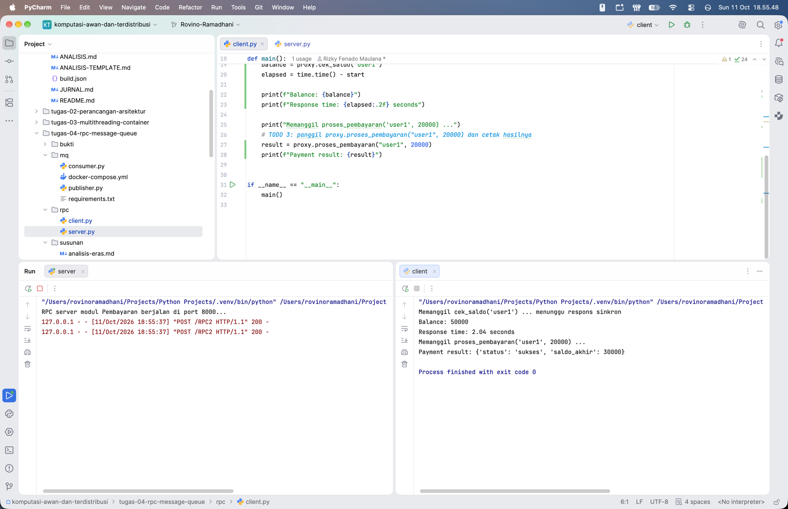
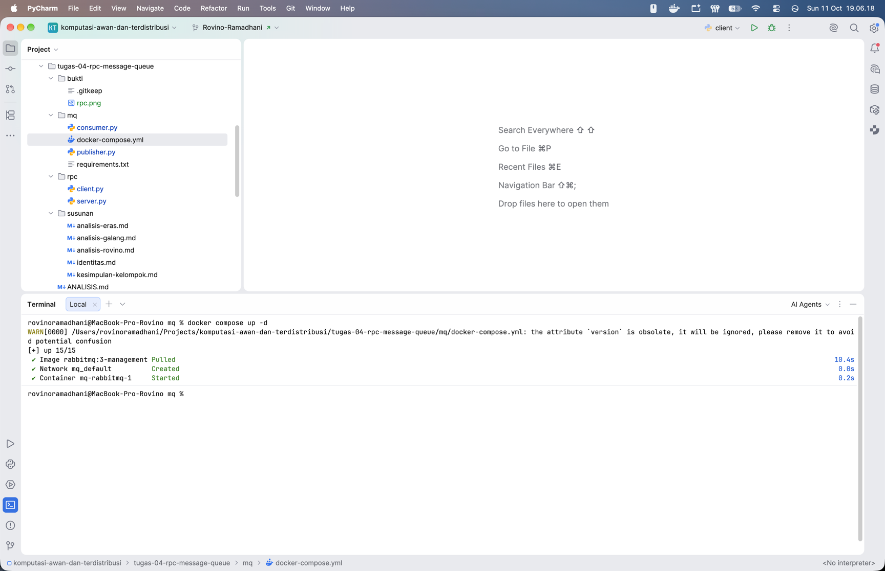
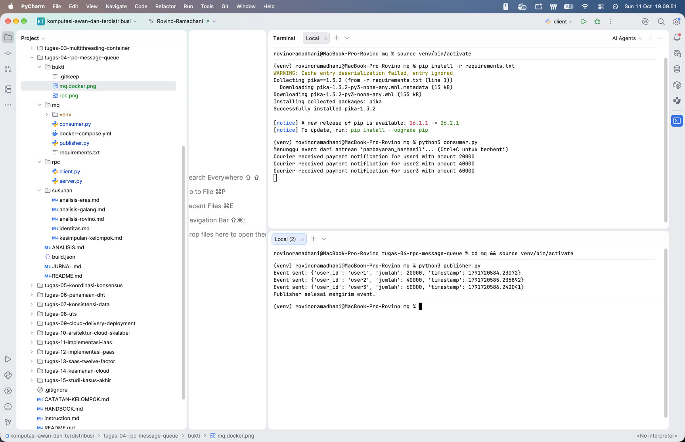
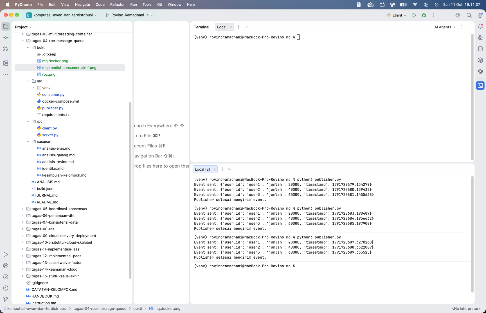
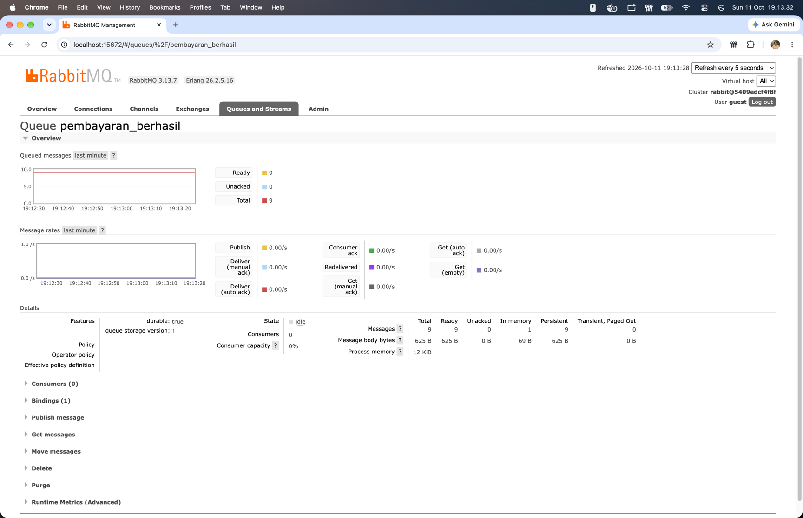
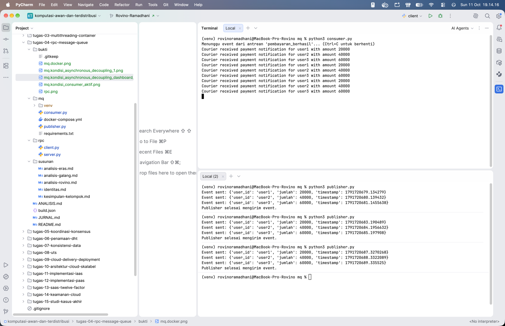

# Jurnal Proses - Tugas 4

## 1. Jalur yang Dipilih

Jalur yang dikerjakan adalah keduanya, yaitu Jalur A - RPC (sinkron) dan Jalur B - Message Queue (asinkron).
Kedua jalur digunakan untuk melihat perbedaan kebutuhan komunikasi antar modul pada studi kasus FoodGo.

1. RPC digunakan pada komunikasi modul Pesanan dengan modul Pembayaran, khususnya untuk pengecekan saldo dan
   pemrosesan pembayaran yang membutuhkan hasil secara langsung.
2. Message Queue digunakan untuk pengiriman event keberhasilan pembayaran dari modul Pembayaran ke modul
   Kurir/Notifikasi. Proses ini tidak harus menunggu modul penerima aktif karena pesan ditampung oleh RabbitMQ.

## 2. Proses Implementasi

### 2.1. Jalur A - RPC

1. Melengkapi bagian `TODO` pada `rpc/server.py`, yaitu fungsi `cek_saldo`, `proses_pembayaran`, serta pendaftaran kedua
   fungsi pada `SimpleXMLRPCServer` di `localhost:8000`.
2. Melengkapi `rpc/client.py` agar memanggil kedua fungsi melalui `ServerProxy` dan mencatat waktu respons pengecekan
   saldo.
3. Menambahkan jeda 2 detik pada proses pengecekan saldo di server untuk memperlihatkan sifat komunikasi sinkron
   (*blocking*).
4. Menjalankan server dan client secara terpisah, kemudian mengamati hasil pemanggilan fungsi.

Hasil pengujian: Pemanggilan `cek_saldo("user1")` mengembalikan saldo 50.000 dengan waktu respons 2,04
detik. Pemanggilan `proses_pembayaran("user1", 20000)` menghasilkan status `sukses` dengan saldo akhir 30.000.
Client baru melanjutkan proses setelah respons server diterima.

Bukti pengujian:

### 2.2. Jalur B - Message Queue

1. Menjalankan RabbitMQ melalui Docker menggunakan konfigurasi pada `mq/docker-compose.yml`.
2. Menyiapkan lingkungan Python dan memasang dependensi `pika` dari `mq/requirements.txt`.
3. Melengkapi `mq/publisher.py` agar terhubung ke RabbitMQ, mendeklarasikan antrean `pembayaran_berhasil` dengan
   `durable=True`, serta mengirimkan pesan dalam format JSON dengan pengaturan pesan persisten.
4. Melengkapi `mq/consumer.py` agar menggunakan antrean yang sama, menerima event pembayaran, menampilkan notifikasi,
   dan mengirimkan *manual acknowledgement* setelah pesan diproses.
5. Menguji komunikasi dengan menjalankan Consumer lebih dahulu, kemudian Publisher.

Hasil pengujian normal: Publisher mengirimkan 3 event, masing-masing untuk `user1` sebesar 20.000, `user2`
sebesar 40.000, dan `user3` sebesar 60.000. Ketiga event diterima dan ditampilkan oleh Consumer.

Bukti menjalankan RabbitMQ melalui Docker:

Bukti komunikasi saat Consumer aktif:

## 3. Kendala Teknis

Selama persiapan terdapat peringatan pada terminal, tetapi tidak terlihat adanya kegagalan yang menghalangi pengujian.

1. Docker Compose: Muncul peringatan bahwa atribut `version` dalam `docker-compose.yml` sudah usang dan diabaikan.
   Pada hasil terminal, image RabbitMQ tetap berhasil diunduh dan container berhasil dijalankan.
2. Instalasi Python: Muncul peringatan `Cache entry deserialization failed, entry ignored` saat memasang dependensi.
   Instalasi tetap selesai dan `pika==1.3.2` terpasang.
3. Koneksi dan eksekusi: Pada screenshot pengujian, RPC berhasil memberikan respons dan Publisher maupun Consumer
   terhubung ke RabbitMQ. Tidak ditemukan pesan error koneksi atau bentrok port pada bukti yang tersedia.

Peringatan tersebut tidak menghentikan pelaksanaan pengujian. Atribut `version` pada konfigurasi Compose dapat
dibersihkan pada perbaikan berikutnya tanpa mengubah hasil percobaan yang sudah didokumentasikan.

## 4. Uji "Pesan Tidak Hilang" (Jalur B)

### 4.1. Langkah Pengujian

1. Menghentikan `consumer.py` sehingga modul Kurir/Notifikasi tidak menerima pesan untuk sementara.
2. Menjalankan `publisher.py` sebanyak 3 kali. Setiap eksekusi mengirimkan 3 event, sehingga terdapat 9
   event yang dipublikasikan.
3. Memeriksa antrean `pembayaran_berhasil` melalui dashboard RabbitMQ pada `http://localhost:15672` ketika Consumer
   tidak aktif.
4. Menjalankan kembali `consumer.py` dan mengamati apakah seluruh pesan yang tertunda diterima.

### 4.2. Hasil yang Diamati

Dashboard RabbitMQ menunjukkan Ready: 9, Unacked: 0, Total: 9, dan Consumers: 0. Ini membuktikan bahwa
sembilan pesan tetap berada di antrean ketika belum ada Consumer yang aktif.

Setelah Consumer dijalankan kembali, terminal menampilkan 9 notifikasi pembayaran dengan urutan tiga kelompok
`user1`, `user2`, dan `user3`. Semua pesan yang terlihat menunggu pada pengujian tersebut diterima dan diproses setelah
Consumer aktif kembali.

Bukti Publisher ketika Consumer tidak aktif:

Bukti 9 pesan tersimpan pada dashboard RabbitMQ:

Bukti pesan diproses setelah Consumer aktif kembali:

### 4.3. Analisis Hasil

Pengujian tersebut memperlihatkan sifat *asynchronous decoupling*. Publisher dapat menyelesaikan pengiriman event tanpa
menunggu Consumer bekerja. Ketika Consumer berhenti, RabbitMQ menyimpan pesan dalam antrean; ketika Consumer aktif
kembali, pesan diteruskan untuk diproses.

Penggunaan `durable=True`, pesan persisten, dan *manual acknowledgement* mendukung keandalan pengiriman. Namun,
pengujian ini hanya membuktikan pesan tetap tersedia selama Consumer dimatikan dan dinyalakan kembali; ketahanan
pesan ketika broker RabbitMQ di- *restart* belum diuji.

## 5. Evaluasi Pemilihan Pola Komunikasi

1. RPC untuk pengecekan saldo dan pembayaran: Tepat karena modul Pesanan membutuhkan hasil langsung untuk menentukan
   kelanjutan transaksi. Konsekuensinya, modul Pesanan menunggu server Pembayaran dan ikut tertahan saat server lambat
   atau tidak merespons.
2. Message Queue untuk notifikasi pembayaran: Tepat karena notifikasi tidak memerlukan balasan langsung. RabbitMQ
   memisahkan waktu pengiriman dan pemrosesan pesan, sehingga ketidakaktifan modul Kurir tidak langsung menghalangi
   Publisher mengirim event.
3. Jika pola ditukar: RPC untuk notifikasi membuat modul Pembayaran bergantung pada respons modul Kurir. Sebaliknya,
   Message Queue untuk pengecekan saldo memerlukan mekanisme tambahan untuk memperoleh dan mencocokkan respons, sehingga
   lebih rumit untuk operasi yang membutuhkan keputusan saat itu juga.

## 6. Kesimpulan Proses

Kedua jalur berhasil diuji pada lingkungan lokal berdasarkan screenshot yang tersedia. RPC menunjukkan proses *blocking*
dengan waktu respons 2,04 detik, sedangkan RabbitMQ menahan 9 pesan saat Consumer tidak aktif dan mengirimkannya
setelah Consumer berjalan kembali. Hasil ini mendukung penggunaan RPC untuk operasi yang memerlukan respons seketika dan
Message Queue untuk notifikasi yang dapat diproses secara asinkron.

Catatan kontribusi: Pembagian tugas per anggota dan riwayat commit tidak dituliskan sebagai hasil pengujian karena
bukti kontribusi individual belum disertakan pada bahan yang ditinjau. Riwayat commit Git perlu tetap dilampirkan sesuai
rubrik penilaian.

## Log Penggunaan AI (Level 2)

> Wajib diisi sesuai kebijakan Level 2 di [`../RUBRIK-UMUM.md`](../RUBRIK-UMUM.md). Tulis "Tidak memakai AI" pada baris
> pertama jika memang tidak dipakai. Hanya untuk brainstorming ide/outline — bukan untuk kode/analisis/teks akhir.

| Tanggal | Tool AI | Prompt yang diberikan | Ringkasan saran/ide AI | Bagaimana diolah jadi tulisan/kode sendiri |
|---------|---------|-----------------------|------------------------|--------------------------------------------|
| ...     | ...     | ...                   | ...                    | ...                                        |
