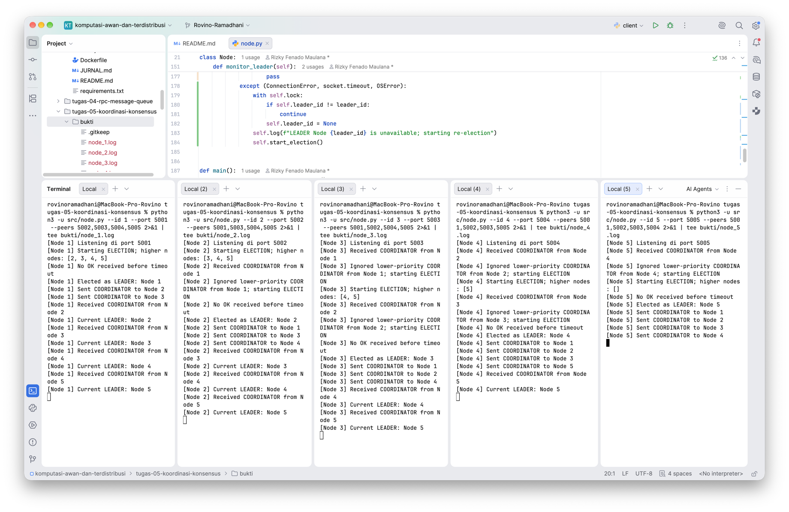
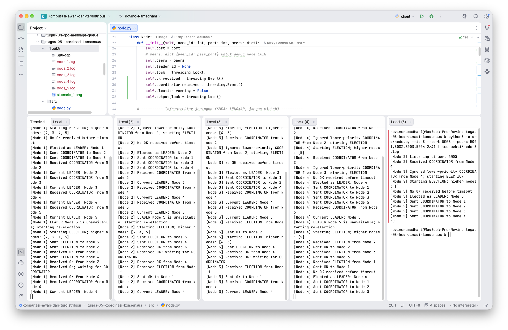

# Jurnal Proses - Tugas 5

## Implementasi Bully

- **Kendala saat mengisi TODO 1-4:**

Pada implementasi `src/node.py`, kelompok melengkapi empat fungsi utama algoritma Bully, yaitu `on_message()`,
`start_election()`, `declare_leader()`, dan `monitor_leader()`.

Kendala yang ditemukan adalah beberapa node sempat mendeklarasikan diri sebagai *leader* sementara karena belum
menerima respons `OK` sebelum batas waktu pemilihan berakhir. Kondisi tersebut terlihat pada pengujian awal ketika
Node 1 hingga Node 4 sempat menjadi pemimpin sebelum Node 5 mengumumkan dirinya sebagai pemimpin akhir.

Untuk menangani proses pemilihan, implementasi menggunakan `threading.Event` sebagai penanda respons `OK` dan
`COORDINATOR`, `threading.Lock` untuk menjaga perubahan status node, serta pemeriksaan prioritas ID agar pesan
`COORDINATOR` dari node ber-ID lebih rendah tidak langsung diterima.

Pemeriksaan ketersediaan pemimpin dilakukan setiap 3 detik melalui `monitor_leader()`, sedangkan batas waktu menunggu
respons `OK` ditetapkan selama 2 detik.

**Bukti implementasi:** [`src/node.py`](src/node.py)

## Skenario 1: Start normal

- **Leader yang terpilih:** Node 5.

- **Log/observasi:**

Pengujian dilakukan dengan menjalankan lima node pada port 5001 hingga 5005. Setiap node melakukan proses pemilihan
dengan mengirimkan pesan `ELECTION` kepada node yang memiliki ID lebih tinggi.

Pada awal proses, Node 1, 2, 3, dan 4 sempat mendeklarasikan diri sebagai pemimpin sementara. Setelah Node 5 aktif,
node tersebut mengumumkan dirinya sebagai pemimpin dan mengirimkan pesan `COORDINATOR` kepada Node 1 hingga Node 4.

Berdasarkan hasil log, seluruh node akhirnya mencatat Node 5 sebagai pemimpin aktif. Dengan demikian, skenario
pemilihan pemimpin awal berhasil dijalankan sesuai prinsip Bully Algorithm.

**Bukti gambar:**



*Gambar 1. Hasil pengujian pemilihan pemimpin awal.*

**Bukti log:**

    1. [Log Node 1](bukti/node_1.log)
    2. [Log Node 2](bukti/node_2.log)
    3. [Log Node 3](bukti/node_3.log)
    4. [Log Node 4](bukti/node_4.log)
    5. [Log Node 5](bukti/node_5.log)

Cuplikan hasil pada `node_5.log`:

  ```
  [Node 5] Elected as LEADER: Node 5
  [Node 5] Sent COORDINATOR to Node 1
  [Node 5] Sent COORDINATOR to Node 2
  [Node 5] Sent COORDINATOR to Node 3
  [Node 5] Sent COORDINATOR to Node 4
  ```

## Skenario 2: Leader dimatikan

- **Leader baru yang terpilih:** Node 4.

- **Berapa lama waktu sampai leader baru terdeteksi:**

Durasi aktual pemilihan ulang belum dapat dihitung secara pasti karena file log tidak mencantumkan *timestamp* setiap
kejadian.

Berdasarkan konfigurasi program, pemeriksaan ketersediaan pemimpin dilakukan setiap 3 detik dan proses pemilihan
menggunakan *timeout* respons `OK` selama 2 detik. Kedua nilai tersebut merupakan konfigurasi program, bukan hasil
pengukuran waktu pemilihan ulang.

Setelah Node 5 dihentikan, node yang masih aktif mendeteksi kegagalan pemimpin dan memulai proses *re-election*.

Node 1, 2, dan 3 mengirimkan pesan `ELECTION` kepada node ber-ID lebih tinggi, kemudian menerima respons `OK` dari
node yang masih aktif. Karena Node 5 tidak memberikan respons, Node 4 akhirnya mendeklarasikan diri sebagai pemimpin
baru dan mengirimkan pesan `COORDINATOR` kepada Node 1, 2, dan 3.

Log menunjukkan seluruh node yang tersisa akhirnya mengenali Node 4 sebagai pemimpin baru tanpa perlu menjalankan
ulang sistem.

**Bukti gambar:**



*Gambar 2. Hasil pengujian pemilihan ulang setelah Node 5 dimatikan.*

**Bukti log:**

    1. [Log Node 1](bukti/node_1.log)
    2. [Log Node 2](bukti/node_2.log)
    3. [Log Node 3](bukti/node_3.log)
    4. [Log Node 4](bukti/node_4.log)

Cuplikan hasil pada `node_4.log`:

  ```
  [Node 4] LEADER Node 5 is unavailable; starting re-election
  [Node 4] Starting ELECTION; higher nodes: [5]
  [Node 4] No OK received before timeout
  [Node 4] Elected as LEADER: Node 4
  [Node 4] Sent COORDINATOR to Node 1
  [Node 4] Sent COORDINATOR to Node 2
  [Node 4] Sent COORDINATOR to Node 3
  ```

## Log Penggunaan AI (Level 2)

> Wajib diisi sesuai kebijakan Level 2 di [`../RUBRIK-UMUM.md`](../RUBRIK-UMUM.md). Tulis "Tidak memakai AI" pada baris
> pertama jika memang tidak dipakai. Hanya untuk brainstorming ide/outline — bukan untuk kode/analisis/teks akhir.

| Tanggal | Tool AI | Prompt yang diberikan | Ringkasan saran/ide AI | Bagaimana diolah jadi tulisan/kode sendiri |
|---------|---------|-----------------------|------------------------|--------------------------------------------|
| ...     | ...     | ...                   | ...                    | ...                                        |
