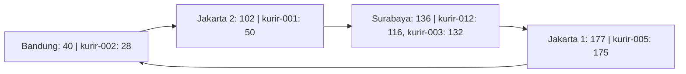
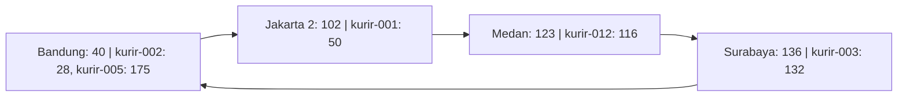

# Tugas 6 (Pekan 6) — Penamaan & Resolusi Lokasi

**Kelompok:** Kelompok 2

| Nama                    | NIM          | Kontribusi                                                                                                                                                                                 |
|-------------------------|--------------|--------------------------------------------------------------------------------------------------------------------------------------------------------------------------------------------|
| Rovino Ramadhani        | 103072400031 | Implementasi simulasi Chord DHT (lookup, join, leave), pengujian dan dokumentasi hasil program, penyusunan jurnal, penulisan analisis individu, serta penyiapan struktur dokumen kelompok. |
| Galang Herjuno Mulya    | 103072430006 |                                                                                                                                                                                            |
| Erastus Liubeta Septian | 103072400020 |                                                                                                                                                                                            |
## Analisis - ditulis oleh Rovino Ramadhani

### 1. Alasan Penggunaan DHT/Chord pada FoodGo

Pada studi kasus FoodGo, setiap kurir memiliki ID tetap, tetapi alamat IP dapat berubah ketika kurir berpindah lokasi
atau menggunakan jaringan yang berbeda. Kondisi ini membutuhkan mekanisme pencarian alamat IP yang mampu memperbarui
mapping tanpa bergantung pada satu server pusat.

Penggunaan DHT dengan algoritma Chord dinilai lebih sesuai karena:

1. Flat naming dengan tabel pusat menyimpan seluruh mapping ID kurir dan alamat IP dalam satu server. Ketika jumlah
   kurir meningkat, server tersebut berpotensi mengalami bottleneck. Jika server mengalami gangguan, proses pencarian
   alamat IP juga dapat terhenti.
2. DNS konvensional menggunakan struktur penamaan hierarkis dan mekanisme caching. Meskipun DNS mendukung pembaruan
   alamat IP, perubahan yang terlalu sering dapat menyebabkan cache menyimpan alamat lama hingga masa TTL berakhir.
3. Chord DHT mendistribusikan tanggung jawab penyimpanan mapping berdasarkan hasil hashing. Setiap ID kurir dipetakan ke
   node successor sehingga proses pencarian tidak harus bergantung pada satu server pusat.

Dengan pendekatan tersebut, FoodGo dapat mempertahankan ID kurir yang sama meskipun alamat IP berubah. Pembaruan IP
cukup dilakukan pada mapping ID kurir, sedangkan penentuan node penanggung jawab mengikuti algoritma consistent hashing.

### 2. Consistent Hashing dan Ring Topology

Simulasi menggunakan ruang identifier 8-bit dengan rentang hash 0 sampai 255. Fungsi SHA-1 digunakan untuk menghasilkan
nilai hash yang kemudian disesuaikan dengan ukuran ring menggunakan operasi modulo 256.

Pada kondisi awal, terdapat empat node yang tersusun berdasarkan nilai hash:

1. Node Bandung dengan ID 40.
2. Node Jakarta 2 dengan ID 102.
3. Node Surabaya dengan ID 136.
4. Node Jakarta 1 dengan ID 177.

Susunan tersebut membentuk ring dengan urutan 40 -> 102 -> 136 -> 177 -> 40.

Setiap ID kurir ditempatkan pada node yang memiliki nilai hash terkecil yang lebih besar atau sama dengan hash key.
Sebagai contoh, `kurir-001` memiliki hash 50 sehingga menjadi tanggung jawab node 102. Sementara itu, `kurir-002`
memiliki hash 28 sehingga ditempatkan pada node 40.

Penggunaan consistent hashing memungkinkan perubahan jumlah node tanpa harus mengubah seluruh pembagian tanggung jawab
mapping. Hanya key pada rentang tertentu yang perlu dialihkan ketika node bergabung atau keluar.

### 3. Perubahan Topologi Saat Join

Pada pengujian join, node Medan dengan ID 123 dan alamat IP `10.0.0.5` ditambahkan ke dalam ring.

Sebelum node tersebut bergabung, `kurir-012` dengan hash 116 menjadi tanggung jawab node 136. Setelah node 123
bergabung, node tersebut menjadi successor terdekat untuk hash 116.

Hasil pengujian menunjukkan:

1. Jumlah node meningkat dari empat menjadi lima.
2. Susunan ring berubah menjadi `[40, 102, 123, 136, 177]`.
3. Mapping `kurir-012` berpindah dari node 136 ke node 123.
4. Total mapping yang berpindah sebanyak satu.

Hasil ini menunjukkan bahwa penambahan node hanya memengaruhi mapping yang berada dalam rentang tanggung jawab node
baru, sedangkan mapping pada node lain tetap dipertahankan.

### 4. Perubahan Topologi Saat Leave

Pada pengujian leave, `node-jakarta-1` dengan ID 177 dikeluarkan dari ring. Sebelum keluar, node tersebut bertanggung
jawab atas `kurir-005` yang memiliki hash 175.

Ketika node 177 dihapus, algoritma mencari successor berikutnya untuk mengambil alih tanggung jawab mapping. Karena
tidak terdapat node dengan ID lebih besar dari 177, pencarian kembali ke awal ring dan menemukan node 40.

Hasil pengujian menunjukkan:

1. Jumlah node berkurang dari lima menjadi empat.
2. Susunan ring berubah menjadi `[40, 102, 123, 136]`.
3. Mapping `kurir-005` berpindah dari node 177 ke node 40.
4. Total mapping yang berpindah sebanyak satu.
5. Lookup `kurir-001` dan `kurir-002` tetap menghasilkan alamat IP yang sesuai.

Perpindahan tersebut menunjukkan bahwa algoritma successor dapat menentukan node pengganti ketika terjadi perubahan
topologi. Mekanisme wrap-around juga memastikan bahwa key tetap memiliki node penanggung jawab selama ring tidak kosong.
## Analisis - Galang Herjuno Mulya

### 1. Pembaruan IP Kurir Tanpa Mengubah Identitas

Pada `register_kurir()`, pemanggilan ulang dengan ID kurir yang sama menimpa tuple pada `self.data[key_hash]`.
Sebagai contoh, setelah `kurir-001` terdaftar dengan IP `192.168.1.10`, pendaftaran ulang menggunakan IP
`192.168.2.10` membuat lookup berikutnya mengembalikan alamat baru. Hash ID kurir tetap 50 sehingga node
penanggung jawab tetap 102 selama topologi tidak berubah. Perubahan IP tidak memerlukan perubahan identitas kurir.

DNS juga mendukung pembaruan dinamis dan penyimpanan terdistribusi, sehingga tidak tepat menganggap DNS selalu
memiliki satu titik gagal. Kesesuaian Chord pada kasus ini terutama berasal dari pembagian mapping ID datar
secara otomatis. Dalam sistem nyata, DHT tetap memerlukan aturan pembaruan dan konsistensi agar hasil lookup
benar-benar mencerminkan IP terbaru, khususnya jika ditambahkan cache atau replikasi.

### 2. Diagram Ring dan Pembagian Mapping

Berikut kondisi awal berdasarkan output `python src/chord_simulation.py` dari folder tugas ini.
Panah menunjukkan urutan node pada ring, bukan jalur komunikasi jaringan yang benar-benar dijalankan program.



Setiap node bertanggung jawab atas interval `(predecessor, node]`. Node 40 menangani interval melingkar
`(177, 40]`, yaitu hash 178 sampai 255 dan 0 sampai 40. Key yang hash-nya tepat sama dengan ID node
menjadi tanggung jawab node tersebut karena pencarian successor memakai perbandingan `>=`.

Setelah Medan bergabung dan Jakarta 1 keluar, kondisi akhirnya adalah:



### 3. Bukti Peralihan Tanggung Jawab dan Batas Implementasi

Eksekusi program menghasilkan cuplikan berikut:

```text
Mapping kurir-012 (hash=116, IP=192.168.1.13): node 136 -> node 123
Total mapping berpindah: 1
Ring saat ini: [40, 102, 123, 136, 177]
Mapping kurir-005 (hash=175, IP=192.168.1.14): node 177 -> node 40
Total mapping berpindah: 1
Ring saat ini: [40, 102, 123, 136]
```

Hasil tersebut memperlihatkan bahwa join hanya mengalihkan key dalam interval `(102, 123]`, sedangkan leave
mengalihkan tanggung jawab node 177 ke successor 40 melalui wrap-around. ID dan IP kurir yang tersimpan tidak berubah.

Namun, seluruh mapping disimpan dalam satu dictionary global `self.data`. Fungsi join dan leave tidak menyalin
atau memindahkan data antarpenyimpanan node; keduanya mengubah anggota ring dan melaporkan perubahan pemilik
berdasarkan hasil `find_successor()`. Dengan demikian, bukti ini menunjukkan perpindahan tanggung jawab secara
logis dalam simulasi single-process, belum membuktikan transfer data melalui jaringan atau ketahanan terhadap
kegagalan server. Output utama juga hanya melakukan lookup kurir-001 dan kurir-002 setelah leave; lookup tersebut
belum secara langsung memeriksa kurir-005 yang tanggung jawabnya berpindah.

### 4. Kondisi Batas dan Penanganan Collision

Implementasi memiliki beberapa pengaman yang belum dibahas pada analisis sebelumnya:

1. Lookup pada ring kosong mengembalikan `None`. Pendaftaran pada ring kosong memicu `ValueError` dari
   `find_successor()` karena belum ada node yang dapat bertanggung jawab.
2. Node terakhir tidak dapat keluar selama masih ada mapping. Kebijakan ini mencegah data kehilangan
   penanggung jawab dalam simulasi, tetapi bukan pengganti replikasi untuk menghadapi kegagalan mendadak.
3. Join ditolak jika hash node sudah terdaftar, termasuk ketika dua nama node berbeda menghasilkan hash sama.
4. Pendaftaran dua ID kurir berbeda dengan hash sama memicu `ValueError`, sehingga mapping lama tidak tertimpa.
   Lookup juga mencocokkan ID asli agar collision tidak mengembalikan IP milik kurir lain.

Ruang 8-bit hanya menyediakan 256 kemungkinan hash sehingga collision menjadi keterbatasan penting.
Penggunaan SHA-1 tidak menghilangkan risiko tersebut setelah hasilnya diperkecil dengan modulo 256.

### 5. Skalabilitas dan Pengembangan Simulasi

`find_successor()` mengurutkan semua node pada setiap pemanggilan, lalu menelusurinya secara berurutan.
Biaya pencarian pada implementasi ini adalah `O(n log n)` untuk pengurutan, ditambah hingga `O(n)` untuk penelusuran.
Join dan leave juga memeriksa mapping untuk menentukan data yang berubah tanggung jawabnya.
Simulasi ini belum memakai finger table dan belum memperlihatkan routing lookup Chord dengan jumlah hop
`O(log n)` pada kondisi ring stabil.

Pengembangan yang sebaiknya dilakukan untuk untuk FoodGo adalah penyimpanan terpisah per node, replikasi mapping ke successor,
ditambah mekanisme stabilisasi dan deteksi kegagalan. Selain pengembangan Pengujian lanjutan perlu diperhatikan, ia perlu untuk memeriksa lookup kurir-012
sesudah join, lookup kurir-005 sesudah leave, dan pendaftaran ulang ID yang sama dengan IP baru.
Skenario tersebut memeriksa mapping yang benar-benar terdampak dan kebutuhan IP dinamis secara langsung.
## Analisis - ditulis oleh Erastus Liubeta Septian

## Kesimpulan Kelompok

Berdasarkan implementasi dan hasil pengujian simulasi Chord DHT pada studi kasus FoodGo, dapat disimpulkan bahwa
mekanisme Distributed Hash Table (DHT) mampu menentukan node penanggung jawab untuk menyimpan mapping ID kurir ke alamat
IP menggunakan consistent hashing dan successor lookup. Penggunaan ruang identifier 8-bit dengan rentang 0 sampai 255
memungkinkan ID node dan ID kurir dipetakan ke dalam satu ring topology yang terstruktur.

Hasil pengujian menunjukkan bahwa:

1. Algoritma `find_successor()` berhasil menentukan node penanggung jawab berdasarkan nilai hash terkecil yang lebih
   besar atau sama dengan hash key.
2. Proses `lookup()` berhasil menemukan alamat IP kurir sesuai mapping yang terdaftar.
3. Proses `join()` berhasil menambahkan node dengan ID 123 dan mengalihkan tanggung jawab mapping `kurir-012` dari node
   136 ke node 123.
4. Proses `leave()` berhasil mengeluarkan node dengan ID 177 dan mengalihkan tanggung jawab mapping `kurir-005` ke node
   40 menggunakan mekanisme wrap-around.
5. Perubahan topologi hanya memengaruhi mapping pada rentang tertentu, sedangkan mapping kurir lainnya tetap dapat
   ditemukan.

Dari sisi penerapan, Chord DHT lebih sesuai untuk kebutuhan FoodGo dibandingkan tabel pusat sederhana karena tanggung
jawab penyimpanan mapping dapat didistribusikan ke beberapa node. Pendekatan ini juga memungkinkan alamat IP kurir
diperbarui tanpa harus mengubah identitas kurir yang digunakan dalam proses pencarian.

Simulasi yang dikembangkan telah memenuhi konsep dasar consistent hashing, ring topology, successor lookup, join, dan
leave. Namun, implementasi masih menggunakan satu proses Python dengan struktur data bersama sehingga perpindahan
mapping yang ditunjukkan merupakan perubahan tanggung jawab secara logis, bukan transfer data antarmesin. Pengujian pada
jaringan terdistribusi sebenarnya masih diperlukan untuk membuktikan ketahanan terhadap kegagalan node dan kemampuan
sistem dalam menangani pembaruan alamat IP secara dinamis.
