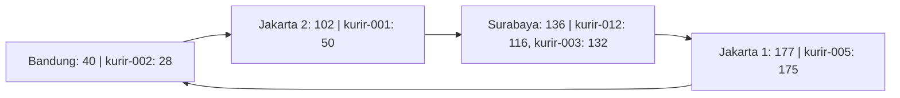
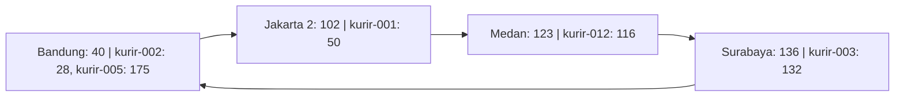
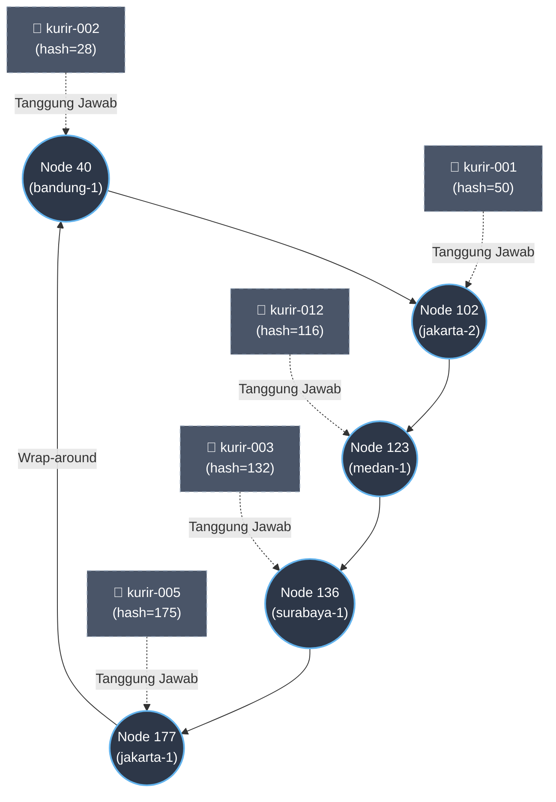

# Tugas 6 (Pekan 6) - Penamaan & Resolusi Lokasi

**Kelompok:** Kelompok 2

| Nama                    | NIM          | Kontribusi                                                                                                                                                                                                                                                                                |
|-------------------------|--------------|-------------------------------------------------------------------------------------------------------------------------------------------------------------------------------------------------------------------------------------------------------------------------------------------|
| Rovino Ramadhani        | 103072400031 | Implementasi simulasi Chord DHT (lookup, join, leave), pengujian dan dokumentasi hasil program, penyusunan jurnal, penulisan analisis individu, serta penyiapan struktur dokumen kelompok.                                                                                                |
| Galang Herjuno Mulya    | 103072430006 | Penyusunan analisis pembaruan IP kurir, visualisasi topologi ring dan distribusi mapping, analisis perpindahan tanggung jawab node, penanganan hash collision, serta evaluasi keterbatasan dan skalabilitas implementasi Chord DHT.                                                       |
| Erastus Liubeta Septian | 103072400020 | Penyusunan analisis perbandingan DHT/Chord dengan Flat Naming dan DNS, visualisasi topologi ring dan pemetaan ID kurir, analisis mekanisme perpindahan tanggung jawab saat node keluar, serta penyusunan kesimpulan terkait desentralisasi, skalabilitas, dan efisiensi pengelolaan data. |
## Analisis Individu - Rovino Ramadhani

### 1. Analisis Penggunaan DHT/Chord

Pada sistem FoodGo, setiap kurir memiliki ID tetap, tetapi alamat IP dapat berubah ketika berpindah jaringan. Penggunaan
DHT/Chord memungkinkan pemetaan ID kurir ke alamat IP dilakukan menggunakan consistent hashing tanpa bergantung pada
satu server pusat.

Dibandingkan flat naming dengan tabel pusat yang berisiko mengalami single point of failure, DHT/Chord membagi tanggung
jawab mapping ke beberapa node. Sementara itu, DNS konvensional memiliki mekanisme caching yang berpotensi menyebabkan
penggunaan alamat IP lama ketika terjadi perubahan jaringan.

### 2. Analisis Hasil Pengujian Lookup

Berdasarkan hasil eksekusi `chord_simulation.py`, simulasi menggunakan ruang identifier 8-bit dengan empat node awal,
yaitu 40, 102, 136, dan 177.

Pengujian menunjukkan bahwa `kurir-001` dengan hash 50 berhasil ditemukan pada node 102 dengan IP `192.168.1.10`.
Sementara itu, `kurir-002` dengan hash 28 ditemukan pada node 40 dengan IP `192.168.1.11`.

Hasil tersebut menunjukkan bahwa fungsi lookup berhasil menerapkan aturan successor, yaitu memilih node dengan ID
terkecil yang lebih besar atau sama dengan nilai hash kurir.

### 3. Analisis Penambahan Node (Join)

Pada pengujian pertama, penambahan node Medan dengan ID 123 belum menghasilkan perpindahan mapping karena belum terdapat
data kurir pada rentang hash yang menjadi tanggung jawab node baru.

Setelah menambahkan `kurir-012` dengan hash 116 dan `kurir-005` dengan hash 175, pengujian menunjukkan perubahan
pembagian tanggung jawab. Ketika node Medan bergabung, mapping `kurir-012` berpindah dari node 136 ke node 123.

Hasil ini menunjukkan bahwa consistent hashing hanya mengubah tanggung jawab mapping pada rentang tertentu ketika node
baru bergabung. Mapping lain tetap berada pada node sebelumnya sehingga tidak diperlukan perubahan seluruh pemetaan
data.

### 4. Analisis Penghapusan Node (Leave)

Pengujian leave dilakukan dengan mengeluarkan node Jakarta 1 yang memiliki ID 177. Sebelum dikeluarkan, node tersebut
bertanggung jawab atas `kurir-005` dengan hash 175.

Setelah node 177 keluar, program mengalihkan tanggung jawab mapping `kurir-005` ke node 40 melalui mekanisme
wrap-around. Output menunjukkan satu mapping berpindah dan susunan ring berubah menjadi `[40, 102, 123, 136]`.

Pengujian lookup setelah perubahan topologi juga menunjukkan bahwa `kurir-001` dan `kurir-002` tetap dapat ditemukan
dengan alamat IP yang sesuai.

### 5. Evaluasi Hasil Implementasi

Berdasarkan pengujian, fungsi lookup, join, dan leave berhasil menunjukkan mekanisme dasar algoritma Chord DHT.
Perubahan jumlah node dapat memengaruhi pembagian tanggung jawab mapping tanpa harus mengubah seluruh data yang
terdaftar.

Namun, implementasi masih berjalan dalam satu proses Python dengan penyimpanan data menggunakan dictionary bersama. Oleh
karena itu, perpindahan mapping yang ditampilkan merupakan perubahan tanggung jawab secara logis, bukan perpindahan data
fisik antarserver. Simulasi juga belum menerapkan replikasi dan mekanisme penanganan kegagalan node secara nyata.
## Analisis - Galang Herjuno Mulya

### 1. Pembaruan IP Kurir Tanpa Mengubah Identitas

Pada `register_kurir()`, pemanggilan ulang dengan ID kurir yang sama menimpa tuple pada `self.data[key_hash]`.
Sebagai contoh, setelah `kurir-001` terdaftar dengan IP `192.168.1.10`, pendaftaran ulang menggunakan IP
`192.168.2.10` membuat lookup berikutnya mengembalikan alamat baru. Hash ID kurir tetap 50 sehingga node
penanggung jawab tetap 102 selama topologi tidak berubah. Perubahan IP tidak memerlukan perubahan identitas kurir.

DNS juga mendukung pembaruan dinamis dan penyimpanan terdistribusi, sehingga tidak tepat menganggap DNS selalu
memiliki satu titik gagal. Kesesuaian Chord pada kasus ini terutama berasal dari pembagian mapping ID datar
secara otomatis. Dalam sistem nyata, DHT tetap memerlukan aturan pembaruan dan konsistensi agar hasil lookup
benar-benar mencerminkan IP terbaru, khususnya jika ditambahkan cache atau replikasi.

### 2. Diagram Ring dan Pembagian Mapping

Berikut kondisi awal berdasarkan output `python src/chord_simulation.py` dari folder tugas ini.
Panah menunjukkan urutan node pada ring, bukan jalur komunikasi jaringan yang benar-benar dijalankan program.



Setiap node bertanggung jawab atas interval `(predecessor, node]`. Node 40 menangani interval melingkar
`(177, 40]`, yaitu hash 178 sampai 255 dan 0 sampai 40. Key yang hash-nya tepat sama dengan ID node
menjadi tanggung jawab node tersebut karena pencarian successor memakai perbandingan `>=`.

Setelah Medan bergabung dan Jakarta 1 keluar, kondisi akhirnya adalah:



### 3. Bukti Peralihan Tanggung Jawab dan Batas Implementasi

Eksekusi program menghasilkan cuplikan berikut:

```text
Mapping kurir-012 (hash=116, IP=192.168.1.13): node 136 -> node 123
Total mapping berpindah: 1
Ring saat ini: [40, 102, 123, 136, 177]
Mapping kurir-005 (hash=175, IP=192.168.1.14): node 177 -> node 40
Total mapping berpindah: 1
Ring saat ini: [40, 102, 123, 136]
```

Hasil tersebut memperlihatkan bahwa join hanya mengalihkan key dalam interval `(102, 123]`, sedangkan leave
mengalihkan tanggung jawab node 177 ke successor 40 melalui wrap-around. ID dan IP kurir yang tersimpan tidak berubah.

Namun, seluruh mapping disimpan dalam satu dictionary global `self.data`. Fungsi join dan leave tidak menyalin
atau memindahkan data antarpenyimpanan node; keduanya mengubah anggota ring dan melaporkan perubahan pemilik
berdasarkan hasil `find_successor()`. Dengan demikian, bukti ini menunjukkan perpindahan tanggung jawab secara
logis dalam simulasi single-process, belum membuktikan transfer data melalui jaringan atau ketahanan terhadap
kegagalan server. Output utama juga hanya melakukan lookup kurir-001 dan kurir-002 setelah leave; lookup tersebut
belum secara langsung memeriksa kurir-005 yang tanggung jawabnya berpindah.

### 4. Kondisi Batas dan Penanganan Collision

Implementasi memiliki beberapa pengaman yang belum dibahas pada analisis sebelumnya:

1. Lookup pada ring kosong mengembalikan `None`. Pendaftaran pada ring kosong memicu `ValueError` dari
   `find_successor()` karena belum ada node yang dapat bertanggung jawab.
2. Node terakhir tidak dapat keluar selama masih ada mapping. Kebijakan ini mencegah data kehilangan
   penanggung jawab dalam simulasi, tetapi bukan pengganti replikasi untuk menghadapi kegagalan mendadak.
3. Join ditolak jika hash node sudah terdaftar, termasuk ketika dua nama node berbeda menghasilkan hash sama.
4. Pendaftaran dua ID kurir berbeda dengan hash sama memicu `ValueError`, sehingga mapping lama tidak tertimpa.
   Lookup juga mencocokkan ID asli agar collision tidak mengembalikan IP milik kurir lain.

Ruang 8-bit hanya menyediakan 256 kemungkinan hash sehingga collision menjadi keterbatasan penting.
Penggunaan SHA-1 tidak menghilangkan risiko tersebut setelah hasilnya diperkecil dengan modulo 256.

### 5. Skalabilitas dan Pengembangan Simulasi

`find_successor()` mengurutkan semua node pada setiap pemanggilan, lalu menelusurinya secara berurutan.
Biaya pencarian pada implementasi ini adalah `O(n log n)` untuk pengurutan, ditambah hingga `O(n)` untuk penelusuran.
Join dan leave juga memeriksa mapping untuk menentukan data yang berubah tanggung jawabnya.
Simulasi ini belum memakai finger table dan belum memperlihatkan routing lookup Chord dengan jumlah hop
`O(log n)` pada kondisi ring stabil.

Pengembangan yang sebaiknya dilakukan untuk untuk FoodGo adalah penyimpanan terpisah per node, replikasi mapping ke successor,
ditambah mekanisme stabilisasi dan deteksi kegagalan. Selain pengembangan Pengujian lanjutan perlu diperhatikan, ia perlu untuk memeriksa lookup kurir-012
sesudah join, lookup kurir-005 sesudah leave, dan pendaftaran ulang ID yang sama dengan IP baru.
Skenario tersebut memeriksa mapping yang benar-benar terdampak dan kebutuhan IP dinamis secara langsung.
## Analisis - ditulis oleh Erastus Liubeta Septian

### 1. Mengapa DHT/Chord lebih cocok dibandingkan Flat Naming atau DNS Konvensional?
Untuk kasus "FoodGo" di mana IP Kurir sangat dinamis (sering berubah) dan membutuhkan arsitektur tanpa titik gagal tunggal (*single point of failure*), DHT/Chord adalah solusi yang paling tepat karena beberapa alasan berikut:

- **Kelemahan Flat Naming Sederhana (Server Pusat):** Jika menggunakan satu tabel pusat, sistem akan memiliki **Titik Gagal Tunggal (Single Point of Failure)**. Jika server pusat tersebut mati (*down*), maka seluruh sistem pencarian IP kurir akan lumpuh total. Selain itu, dengan IP kurir yang sering berubah, server pusat akan menjadi *bottleneck* karena harus melayani jutaan *request update* IP secara bersamaan.

- **Kelemahan DNS Konvensional:** DNS didesain dengan sistem *caching* (penyimpanan sementara) di berbagai level (ISP, OS, Browser) dengan waktu hidup (TTL). Karena IP kurir bersifat dinamis dan sangat sering berpindah jaringan, *caching* pada DNS akan menyebabkan data menjadi basi (*stale data*). Pelanggan bisa jadi diarahkan ke alamat IP lama kurir. Proses propagasi/pembaruan data DNS di seluruh dunia juga memakan waktu yang tidak cocok untuk *update* *real-time*.

* **Keunggulan DHT/Chord:**

  * **Tanpa Titik Gagal Tunggal:** Data mapping ID Kurir ke IP disebar (*distributed*) ke banyak *node*. Tidak ada server pusat. Jika ada satu *node* yang mati atau keluar, tanggung jawabnya secara otomatis dialihkan ke *node* tetangganya (*successor*).

  * **Skalabilitas & Beban Merata:** Berkat *consistent hashing*, beban penyimpanan data dan *request lookup* dibagi secara adil dan merata ke seluruh *node* yang ada di dalam *ring*.

  * **Penanganan Dinamis:** Sangat efisien untuk menangani data yang sering berubah. Pembaruan IP hanya perlu di-rutekan ke satu *node* penanggung jawab yang tepat tanpa masalah *caching delay* seperti DNS.

### 2. Topologi Ring (Simulasi DHT)
Berikut adalah visualisasi *ring topology* sesaat setelah 4 node awal bergabung, kurir didaftarkan, dan node `node-medan-1` baru saja bergabung (sebelum ada node yang keluar).

Ruang Identifier: $m = 8$ bit (0-255). Aturan: Kunci disimpan di *node* dengan ID terkecil yang $\ge$ nilai *hash* kunci (disebut *successor*).



### 3. Apa yang terjadi pada mapping saat sebuah node keluar dari ring?
Berdasarkan algoritma Chord, ketika sebuah *node* keluar (*leave*) atau mati, rentang tanggung jawabnya dan seluruh data yang dipegangnya akan **diambil alih oleh node successor-nya** (node selanjutnya di dalam ring).

**Bukti dari Output Program:**
Pada skenario simulasi, `node-jakarta-1` dengan `ID = 177` keluar dari *ring*.
Susunan *ring* sebelum keluar adalah: `[40, 102, 123, 136, 177]`

1. **Siapa successor-nya?** Karena `177` adalah ID terbesar, *successor*-nya akan melingkar (*wrap-around*) kembali ke ID terkecil, yaitu **Node 40** (`node-bandung-1`).

2. **Pemindahan Rentang Tanggung Jawab:** Rentang antara *predecessor* dari node 177 (yaitu 136) hingga node 177, berpindah ke node 40.

   * *Output terminal:* `Rentang (136, 177] beralih dari node 177 ke node 40`

3. **Pemindahan Data (Mapping):** Node 177 sebelumnya memegang data `kurir-005` (hash=175). Karena node 177 keluar, data ini harus dipindahkan ke node 40.

   * *Output terminal:* `Mapping kurir-005 (hash=175, IP=192.168.1.14): node 177 -> node 40`

Sistem ini memastikan bahwa meskipun ada *node* yang hilang dari jaringan, data pelanggan (ID kurir -> IP) tidak hilang, melainkan aman dialihkan ke *node* yang masih aktif sehingga pencarian (*lookup*) selanjutnya tetap berhasil.

### Kesimpulan
Berdasarkan analisis studi kasus simulasi Chord DHT pada sistem FoodGo, dapat ditarik kesimpulan sebagai berikut:

1. **Penyelesaian Masalah Keterpusatan (Desentralisasi):** Sistem DHT/Chord berhasil menghilangkan *Single Point of Failure* (SPOF) dan *bottleneck* yang menjadi kelemahan utama pada sistem *flat naming* atau DNS konvensional. Tidak ada satu server pusat yang membebani jaringan.
2. **Adaptabilitas Tinggi terhadap Perubahan Dinamis:** Pendekatan ini sangat efektif untuk mengelola alamat IP kurir yang terus berubah. Melalui *consistent hashing*, pencarian (*lookup*) ID kurir dapat dilakukan secara terarah dan terdistribusi merata ke seluruh *node* yang aktif di dalam topologi cincin (*ring*).
3. **Efisiensi Manajemen Data (Minimisasi Migrasi):** Ketika terjadi perubahan topologi (seperti *node* baru yang bergabung atau *node* lama yang keluar), sistem tidak perlu melakukan *hashing* ulang pada seluruh data. Tanggung jawab penyimpanan pemetaan ID ke IP hanya dialihkan pada *node* penerus (*successor*) terdekatnya, sehingga beban komputasi dan jaringan sangat minimal.
4. **Skalabilitas yang Mandiri:** Penambahan maupun pengurangan *node* (server) dapat dilakukan secara dinamis kapan saja tanpa menghentikan operasi pelacakan kurir secara keseluruhan, menjadikan arsitektur ini sangat stabil untuk skala implementasi yang luas.

## Kesimpulan Kelompok

Berdasarkan implementasi dan hasil pengujian simulasi Chord DHT pada studi kasus FoodGo, dapat disimpulkan bahwa
mekanisme Distributed Hash Table (DHT) mampu menentukan node penanggung jawab untuk menyimpan mapping ID kurir ke alamat
IP menggunakan consistent hashing dan successor lookup. Penggunaan ruang identifier 8-bit dengan rentang 0 sampai 255
memungkinkan ID node dan ID kurir dipetakan ke dalam satu ring topology yang terstruktur.

Hasil pengujian menunjukkan bahwa:

1. Algoritma `find_successor()` berhasil menentukan node penanggung jawab berdasarkan nilai hash terkecil yang lebih
   besar atau sama dengan hash key.
2. Proses `lookup()` berhasil menemukan alamat IP kurir sesuai mapping yang terdaftar.
3. Proses `join()` berhasil menambahkan node dengan ID 123 dan mengalihkan tanggung jawab mapping `kurir-012` dari node
   136 ke node 123.
4. Proses `leave()` berhasil mengeluarkan node dengan ID 177 dan mengalihkan tanggung jawab mapping `kurir-005` ke node
   40 menggunakan mekanisme wrap-around.
5. Perubahan topologi hanya memengaruhi mapping pada rentang tertentu, sedangkan mapping kurir lainnya tetap dapat
   ditemukan.

Dari sisi penerapan, Chord DHT lebih sesuai untuk kebutuhan FoodGo dibandingkan tabel pusat sederhana karena tanggung
jawab penyimpanan mapping dapat didistribusikan ke beberapa node. Pendekatan ini juga memungkinkan alamat IP kurir
diperbarui tanpa harus mengubah identitas kurir yang digunakan dalam proses pencarian.

Simulasi yang dikembangkan telah memenuhi konsep dasar consistent hashing, ring topology, successor lookup, join, dan
leave. Namun, implementasi masih menggunakan satu proses Python dengan struktur data bersama sehingga perpindahan
mapping yang ditunjukkan merupakan perubahan tanggung jawab secara logis, bukan transfer data antarmesin. Pengujian pada
jaringan terdistribusi sebenarnya masih diperlukan untuk membuktikan ketahanan terhadap kegagalan node dan kemampuan
sistem dalam menangani pembaruan alamat IP secara dinamis.
