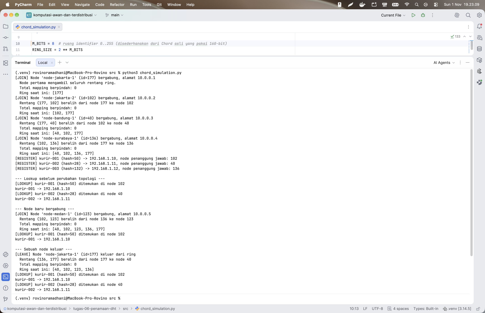
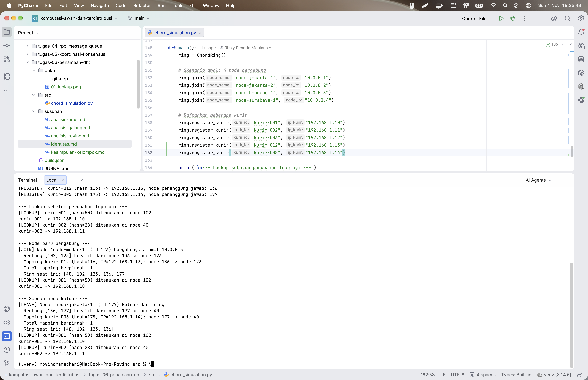
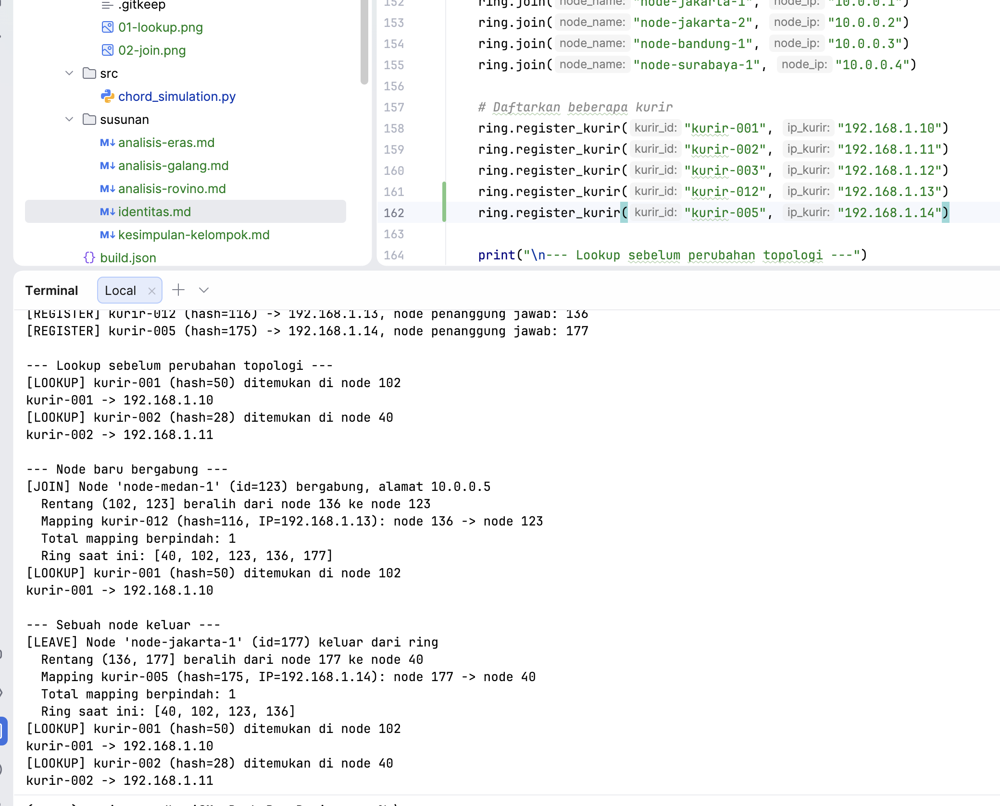

# Jurnal Proses - Tugas 6

## Implementasi find_successor

1. Kesalahan pertama yang ditemui

   Pada kode awal, fungsi `find_successor()` masih berisi `pass` sehingga belum dapat menentukan node penanggung jawab
   berdasarkan hash ID kurir. Selain itu, algoritma harus menangani kondisi wrap-around ketika nilai hash key lebih
   besar daripada seluruh ID node dalam ring.

2. Cara memperbaikinya

   Mengimplementasikan algoritma pencarian successor dengan mengurutkan ID node menggunakan `sorted(self.nodes)`,
   kemudian mencari node dengan ID terkecil yang lebih besar atau sama dengan hash key. Jika tidak ditemukan, algoritma
   mengembalikan ID node terkecil sebagai mekanisme wrap-around.

3. Hasil pengujian

   Pengujian dilakukan dengan menjalankan `chord_simulation.py`. Hasilnya menunjukkan bahwa proses registrasi dan lookup
   berhasil.

   a. `kurir-001` memiliki hash 50, disimpan pada node 102, dan menghasilkan IP `192.168.1.10`.

   b. `kurir-002` memiliki hash 28, disimpan pada node 40, dan menghasilkan IP `192.168.1.11`.

   c. Seluruh node berhasil diurutkan berdasarkan nilai hash dalam ring.

   Bukti pengujian lookup:

   

## Skenario join/leave

1. Hasil sebelum dan sesudah node baru bergabung (JOIN)

   Pengujian dilakukan dengan menambahkan `kurir-012` dan `kurir-005` untuk memastikan terdapat mapping yang berpindah
   saat topologi berubah.

   a. Sebelum proses join, terdapat empat node dengan ID `[40, 102, 136, 177]`.

   b. `kurir-012` memiliki hash 116 dan awalnya menjadi tanggung jawab node 136.

   c. Node baru `node-medan-1` dengan ID 123 dan IP `10.0.0.5` bergabung ke ring.

   d. Mapping `kurir-012` berpindah dari node 136 ke node 123 karena node baru menjadi successor terdekat untuk hash
   116.

   e. Setelah join, susunan ring menjadi `[40, 102, 123, 136, 177]` dengan total satu mapping berpindah.

   Bukti pengujian JOIN:

   

2. Hasil sebelum dan sesudah node keluar (LEAVE)

   Pengujian dilakukan dengan mengeluarkan `node-jakarta-1` dari ring setelah proses join selesai.

   a. Sebelum proses leave, terdapat lima node dengan ID `[40, 102, 123, 136, 177]`.

   b. `kurir-005` memiliki hash 175 dan awalnya menjadi tanggung jawab node 177.

   c. `node-jakarta-1` dengan ID 177 keluar dari ring.

   d. Mapping `kurir-005` berpindah dari node 177 ke node 40 melalui mekanisme wrap-around karena node 40 merupakan
   successor berikutnya.

   e. Setelah leave, susunan ring menjadi `[40, 102, 123, 136]` dengan total satu mapping berpindah.

   f. Proses lookup `kurir-001` dan `kurir-002` tetap berhasil menghasilkan alamat IP yang sesuai.

   Bukti pengujian LEAVE:

   

3. Kesimpulan pengujian

   Simulasi berhasil menerapkan consistent hashing, successor lookup, ring topology, serta perubahan tanggung jawab
   mapping pada proses join dan leave. Perubahan topologi tidak mengubah alamat IP kurir yang telah terdaftar, tetapi
   mengubah node yang bertanggung jawab menyimpan mapping sesuai aturan Chord DHT.

## Log Penggunaan AI (Level 2)

> Wajib diisi sesuai kebijakan Level 2 di [`../RUBRIK-UMUM.md`](../RUBRIK-UMUM.md). Tulis "Tidak memakai AI" pada baris
> pertama jika memang tidak dipakai. Hanya untuk brainstorming ide/outline — bukan untuk kode/analisis/teks akhir.

| Tanggal | Tool AI | Prompt yang diberikan | Ringkasan saran/ide AI | Bagaimana diolah jadi tulisan/kode sendiri |
|---------|---------|-----------------------|------------------------|--------------------------------------------|
| ...     | ...     | ...                   | ...                    | ...                                        |
