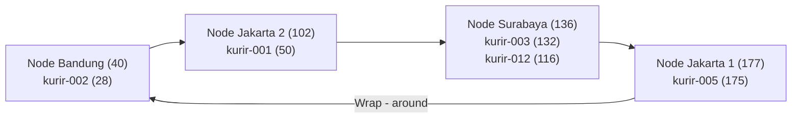
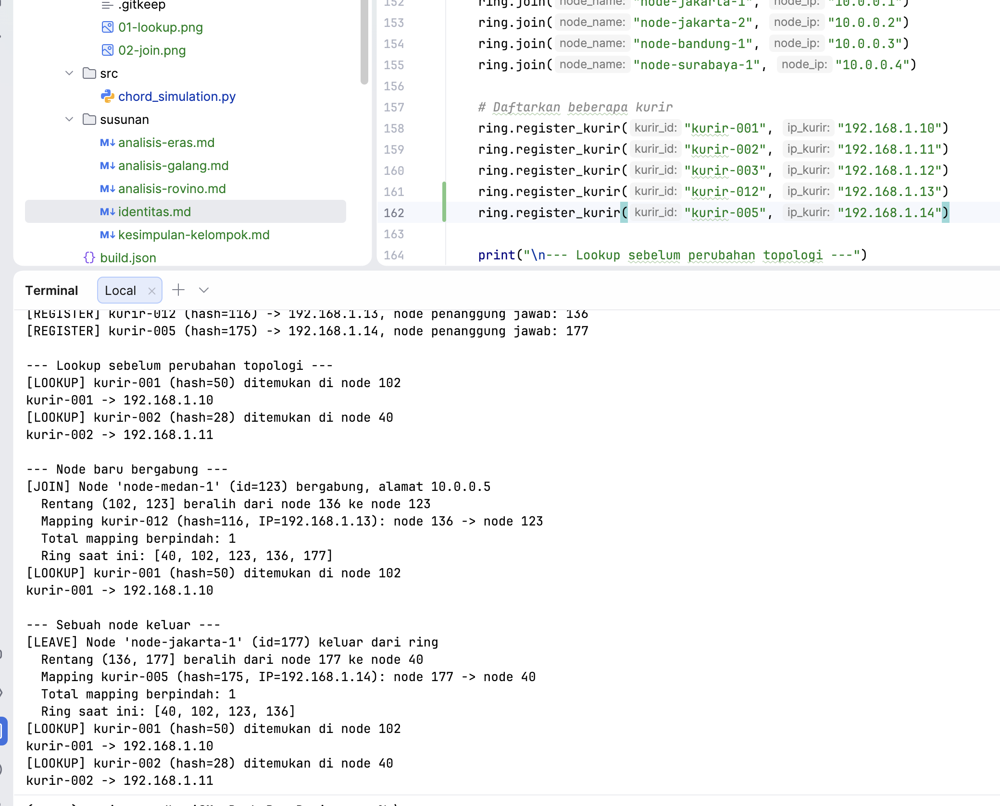
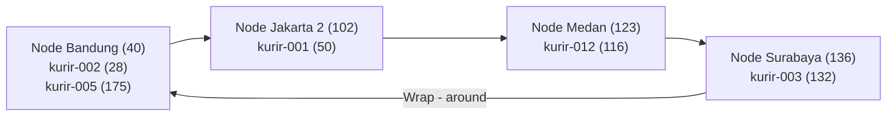

# Tugas 6 (Pekan 6) — Penamaan & Resolusi Lokasi

**Materi terkait:** Flat Naming, Structured Naming (DNS), Distributed Hash Table (DHT)/Chord.

## Studi Kasus

Pelanggan FoodGo kesulitan menemukan alamat IP server kurir yang **dinamis** (kurir berpindah lokasi/jaringan, IP-nya
sering berubah). FoodGo butuh cara memetakan **ID Kurir** (identitas tetap) ke **alamat IP terkininya** tanpa server
pusat tunggal yang jadi bottleneck/single point of failure.

## Tugas Kelompok

Implementasikan **simulasi Chord DHT** sederhana (single-process, tidak perlu jaringan sungguhan — cukup simulasi
struktur data & algoritma di satu program Python) yang memetakan ID Kurir ke alamat IP mereka.

Konsep yang harus terlihat jalan dalam simulasi kalian:

1. **Consistent hashing**: ID Kurir dan ID Node di-hash ke ruang angka yang sama (mis. 0–255 untuk kesederhanaan, `m=8`
   bit).
2. **Ring topology**: node-node diurutkan melingkar berdasarkan hasil hash-nya.
3. **Lookup**: fungsi `lookup(kurir_id)` yang menemukan node mana yang bertanggung jawab menyimpan mapping ID Kurir
   tersebut → alamat IP-nya (aturan Chord: node dengan ID hash **terkecil yang lebih besar atau sama dengan** hash key,
   disebut *successor*).
4. **Perubahan topologi**: simulasikan minimal satu node baru bergabung (`join`) atau satu node keluar (`leave`),
   tunjukkan bagaimana mapping berpindah tanggung jawab ke node lain.

Skeleton disediakan di `src/chord_simulation.py` dengan fungsi hashing dan struktur ring sudah ada — bagian `lookup()`,
`join()`, dan `leave()` sengaja dikosongkan.

### Cara Menjalankan

```bash
python3 src/chord_simulation.py
```

## Tugas Analisis (`README.md`)

## 1. Mengapa DHT/Chord Lebih Cocok Dibandingkan Flat Naming atau DNS?

Pada studi kasus FoodGo, setiap kurir memiliki ID tetap, tetapi alamat IP dapat berubah ketika kurir berpindah lokasi
atau jaringan. Oleh karena itu, diperlukan mekanisme pemetaan ID kurir ke alamat IP terbaru tanpa bergantung pada satu
server pusat.

Penggunaan DHT dengan algoritma Chord lebih sesuai karena:

1. **Flat Naming:** Penggunaan tabel pusat ID ke IP berpotensi menyebabkan bottleneck ketika jumlah kurir meningkat.
   Jika server pusat mengalami gangguan, seluruh proses pencarian alamat IP dapat terhenti.
2. **DNS Konvensional:** DNS menggunakan mekanisme caching yang dapat menyebabkan alamat IP lama tetap digunakan hingga
   masa TTL berakhir. Kondisi ini kurang ideal untuk alamat IP kurir yang sering berubah.
3. **DHT/Chord:** Menggunakan consistent hashing untuk membagi tanggung jawab mapping ke beberapa node. Setiap ID kurir
   dipetakan ke node successor sehingga tidak bergantung pada satu tabel pusat.

Dengan pendekatan Chord, perubahan alamat IP cukup diperbarui pada mapping tanpa mengubah ID kurir. Namun, implementasi
terdistribusi sebenarnya tetap membutuhkan replikasi dan mekanisme pemulihan untuk menghindari kehilangan data saat node
mengalami kegagalan.

## 2. Ring Topology dan Pembagian Mapping ID Kurir

Simulasi menggunakan ruang identifier 8-bit dengan rentang hash 0 sampai 255. Fungsi SHA-1 digunakan untuk menghasilkan
nilai hash yang disesuaikan menggunakan operasi modulo 256.

Pada kondisi awal terdapat empat node dengan urutan ring 40 -> 102 -> 136 -> 177 -> 40.

Setiap ID kurir menjadi tanggung jawab node yang memiliki ID terkecil yang lebih besar atau sama dengan nilai hash kurir
(successor).



Pembagian tanggung jawab mapping berdasarkan hasil simulasi:

| ID Kurir  | Hash | Node Penanggung Jawab |
|-----------|------|-----------------------|
| kurir-001 | 50   | Jakarta 2 (102)       |
| kurir-002 | 28   | Bandung (40)          |
| kurir-003 | 132  | Surabaya (136)        |
| kurir-012 | 116  | Surabaya (136)        |
| kurir-005 | 175  | Jakarta 1 (177)       |

Sebagai contoh, proses `lookup("kurir-001")` menghasilkan hash 50. Algoritma memeriksa node berdasarkan urutan
`[40, 102, 136, 177]`. Node 40 dilewati karena nilainya lebih kecil dari 50, sedangkan node 102 menjadi successor karena
merupakan ID terkecil yang lebih besar atau sama dengan 50.

Fungsi lookup kemudian mengembalikan alamat IP `192.168.1.10`. Hasil ini menunjukkan bahwa penentuan node penanggung
jawab dilakukan berdasarkan nilai hash, bukan lokasi geografis kurir.

## 3. Perubahan Mapping Ketika Node Keluar dari Ring

Pada pengujian, node Medan dengan ID 123 terlebih dahulu bergabung sehingga susunan ring menjadi
`[40, 102, 123, 136, 177]`. Setelah itu, `node-jakarta-1` dengan ID 177 dikeluarkan dari ring.

Sebelum keluar, node 177 bertanggung jawab atas `kurir-005` dengan hash 175 dan alamat IP `192.168.1.14`.

Ketika node 177 dihapus, algoritma mencari node successor berikutnya. Karena tidak terdapat node dengan ID lebih besar
dari 177, pencarian menggunakan mekanisme wrap-around dan menemukan node Bandung dengan ID 40.

**Bukti output program:**



Setelah node 177 keluar, topologi ring berubah menjadi:



Berdasarkan hasil pengujian, hanya satu mapping yang mengalami perubahan tanggung jawab, yaitu `kurir-005` dari node 177
ke node 40. Sementara itu, lookup terhadap `kurir-001` dan `kurir-002` tetap menghasilkan alamat IP yang sesuai.

Perubahan tersebut membuktikan bahwa mekanisme consistent hashing dapat menentukan node pengganti tanpa mengubah seluruh
mapping dalam ring.

Namun, simulasi masih menggunakan satu proses Python dengan dictionary `self.data`, sehingga perpindahan mapping yang
ditampilkan merupakan perubahan tanggung jawab secara logis, bukan transfer data secara fisik antarserver.

## Struktur Submission

```
tugas-06-penamaan-dht/
├── README.md      # Analisis + diagram ring
├── JURNAL.md
├── src/
│   └── chord_simulation.py
└── bukti/          # Output program (screenshot/log) untuk skenario join & leave
```

## Rubrik Penilaian (Tugas 6)

| Komponen                               | Bobot | Kriteria                                                        |
|----------------------------------------|-------|-----------------------------------------------------------------|
| Implementasi lookup/join/leave benar   | 35%   | Consistent hashing & successor lookup sesuai aturan Chord       |
| Bukti perubahan topologi (join/leave)  | 25%   | Output menunjukkan mapping berpindah dengan benar               |
| Analisis kenapa DHT vs flat naming/DNS | 25%   | Argumen spesifik ke kasus IP kurir dinamis, bukan definisi umum |
| Proses & kontribusi kelompok           | 15%   | `JURNAL.md`, commit history                                     |

## Batasan Penggunaan AI (Level 2)

Kebijakan **Level 2 (AI Assisted Idea Generation & Structuring)** berlaku — lihat [
`../RUBRIK-UMUM.md`](../RUBRIK-UMUM.md). Boleh bertanya konsep umum consistent hashing/Chord ke AI; **tidak boleh**
meminta AI menuliskan isi `# TODO` di `src/chord_simulation.py` (`find_successor`, `join`, `leave`, dst). Catat
pemakaian AI di "Log Penggunaan AI" pada `JURNAL.md`.

- `README.md` wajib menelusuri manual (langkah demi langkah) bagaimana `lookup()` menemukan successor untuk salah satu
  ID Kurir contoh yang dipakai di `chord_simulation.py` — bukan cuma menempelkan output program.
