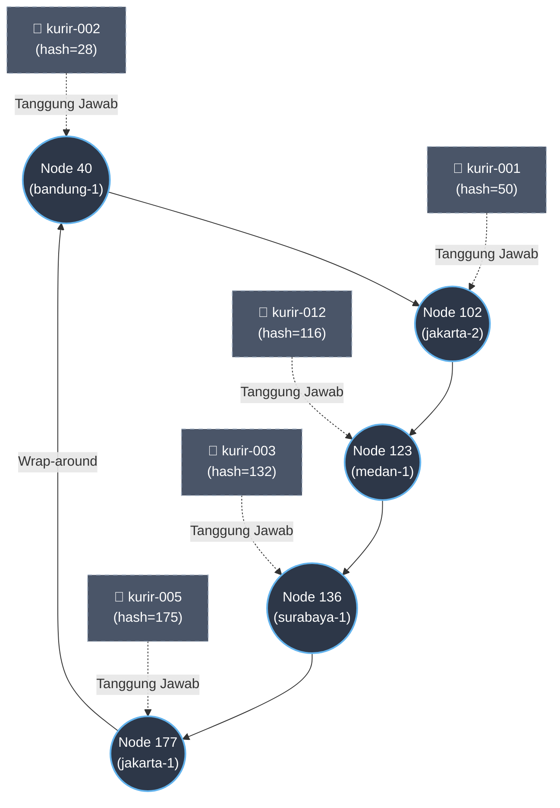

## Analisis - ditulis oleh Erastus Liubeta Septian

### 1. Mengapa DHT/Chord lebih cocok dibandingkan Flat Naming atau DNS Konvensional?
Untuk kasus "FoodGo" di mana IP Kurir sangat dinamis (sering berubah) dan membutuhkan arsitektur tanpa titik gagal tunggal (*single point of failure*), DHT/Chord adalah solusi yang paling tepat karena beberapa alasan berikut:

- **Kelemahan Flat Naming Sederhana (Server Pusat):** Jika menggunakan satu tabel pusat, sistem akan memiliki **Titik Gagal Tunggal (Single Point of Failure)**. Jika server pusat tersebut mati (*down*), maka seluruh sistem pencarian IP kurir akan lumpuh total. Selain itu, dengan IP kurir yang sering berubah, server pusat akan menjadi *bottleneck* karena harus melayani jutaan *request update* IP secara bersamaan.

- **Kelemahan DNS Konvensional:** DNS didesain dengan sistem *caching* (penyimpanan sementara) di berbagai level (ISP, OS, Browser) dengan waktu hidup (TTL). Karena IP kurir bersifat dinamis dan sangat sering berpindah jaringan, *caching* pada DNS akan menyebabkan data menjadi basi (*stale data*). Pelanggan bisa jadi diarahkan ke alamat IP lama kurir. Proses propagasi/pembaruan data DNS di seluruh dunia juga memakan waktu yang tidak cocok untuk *update* *real-time*.

* **Keunggulan DHT/Chord:**

  * **Tanpa Titik Gagal Tunggal:** Data mapping ID Kurir ke IP disebar (*distributed*) ke banyak *node*. Tidak ada server pusat. Jika ada satu *node* yang mati atau keluar, tanggung jawabnya secara otomatis dialihkan ke *node* tetangganya (*successor*).

  * **Skalabilitas & Beban Merata:** Berkat *consistent hashing*, beban penyimpanan data dan *request lookup* dibagi secara adil dan merata ke seluruh *node* yang ada di dalam *ring*.

  * **Penanganan Dinamis:** Sangat efisien untuk menangani data yang sering berubah. Pembaruan IP hanya perlu di-rutekan ke satu *node* penanggung jawab yang tepat tanpa masalah *caching delay* seperti DNS.

### 2. Topologi Ring (Simulasi DHT)
Berikut adalah visualisasi *ring topology* sesaat setelah 4 node awal bergabung, kurir didaftarkan, dan node `node-medan-1` baru saja bergabung (sebelum ada node yang keluar).

Ruang Identifier: $m = 8$ bit (0-255). Aturan: Kunci disimpan di *node* dengan ID terkecil yang $\ge$ nilai *hash* kunci (disebut *successor*).

### 3. Apa yang terjadi pada mapping saat sebuah node keluar dari ring?
Berdasarkan algoritma Chord, ketika sebuah *node* keluar (*leave*) atau mati, rentang tanggung jawabnya dan seluruh data yang dipegangnya akan **diambil alih oleh node successor-nya** (node selanjutnya di dalam ring).

**Bukti dari Output Program:**
Pada skenario simulasi, `node-jakarta-1` dengan `ID = 177` keluar dari *ring*.
Susunan *ring* sebelum keluar adalah: `[40, 102, 123, 136, 177]`

1. **Siapa successor-nya?** Karena `177` adalah ID terbesar, *successor*-nya akan melingkar (*wrap-around*) kembali ke ID terkecil, yaitu **Node 40** (`node-bandung-1`).

2. **Pemindahan Rentang Tanggung Jawab:** Rentang antara *predecessor* dari node 177 (yaitu 136) hingga node 177, berpindah ke node 40.

   * *Output terminal:* `Rentang (136, 177] beralih dari node 177 ke node 40`

3. **Pemindahan Data (Mapping):** Node 177 sebelumnya memegang data `kurir-005` (hash=175). Karena node 177 keluar, data ini harus dipindahkan ke node 40.

   * *Output terminal:* `Mapping kurir-005 (hash=175, IP=192.168.1.14): node 177 -> node 40`

Sistem ini memastikan bahwa meskipun ada *node* yang hilang dari jaringan, data pelanggan (ID kurir -> IP) tidak hilang, melainkan aman dialihkan ke *node* yang masih aktif sehingga pencarian (*lookup*) selanjutnya tetap berhasil.

### Kesimpulan
Berdasarkan analisis studi kasus simulasi Chord DHT pada sistem FoodGo, dapat ditarik kesimpulan sebagai berikut:

1. **Penyelesaian Masalah Keterpusatan (Desentralisasi):** Sistem DHT/Chord berhasil menghilangkan *Single Point of Failure* (SPOF) dan *bottleneck* yang menjadi kelemahan utama pada sistem *flat naming* atau DNS konvensional. Tidak ada satu server pusat yang membebani jaringan.
2. **Adaptabilitas Tinggi terhadap Perubahan Dinamis:** Pendekatan ini sangat efektif untuk mengelola alamat IP kurir yang terus berubah. Melalui *consistent hashing*, pencarian (*lookup*) ID kurir dapat dilakukan secara terarah dan terdistribusi merata ke seluruh *node* yang aktif di dalam topologi cincin (*ring*).
3. **Efisiensi Manajemen Data (Minimisasi Migrasi):** Ketika terjadi perubahan topologi (seperti *node* baru yang bergabung atau *node* lama yang keluar), sistem tidak perlu melakukan *hashing* ulang pada seluruh data. Tanggung jawab penyimpanan pemetaan ID ke IP hanya dialihkan pada *node* penerus (*successor*) terdekatnya, sehingga beban komputasi dan jaringan sangat minimal.
4. **Skalabilitas yang Mandiri:** Penambahan maupun pengurangan *node* (server) dapat dilakukan secara dinamis kapan saja tanpa menghentikan operasi pelacakan kurir secara keseluruhan, menjadikan arsitektur ini sangat stabil untuk skala implementasi yang luas.
