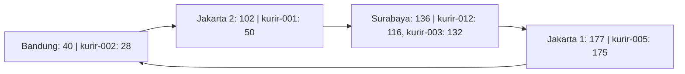
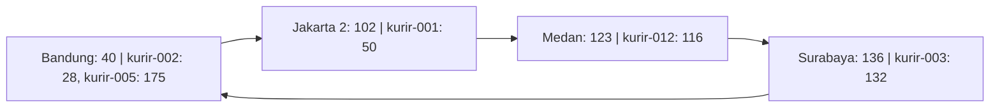

## Analisis - Galang Herjuno Mulya

### 1. Pembaruan IP Kurir Tanpa Mengubah Identitas

Pada `register_kurir()`, pemanggilan ulang dengan ID kurir yang sama menimpa tuple pada `self.data[key_hash]`.
Sebagai contoh, setelah `kurir-001` terdaftar dengan IP `192.168.1.10`, pendaftaran ulang menggunakan IP
`192.168.2.10` membuat lookup berikutnya mengembalikan alamat baru. Hash ID kurir tetap 50 sehingga node
penanggung jawab tetap 102 selama topologi tidak berubah. Perubahan IP tidak memerlukan perubahan identitas kurir.

DNS juga mendukung pembaruan dinamis dan penyimpanan terdistribusi, sehingga tidak tepat menganggap DNS selalu
memiliki satu titik gagal. Kesesuaian Chord pada kasus ini terutama berasal dari pembagian mapping ID datar
secara otomatis. Dalam sistem nyata, DHT tetap memerlukan aturan pembaruan dan konsistensi agar hasil lookup
benar-benar mencerminkan IP terbaru, khususnya jika ditambahkan cache atau replikasi.

### 2. Diagram Ring dan Pembagian Mapping

Berikut kondisi awal berdasarkan output `python src/chord_simulation.py` dari folder tugas ini.
Panah menunjukkan urutan node pada ring, bukan jalur komunikasi jaringan yang benar-benar dijalankan program.



Setiap node bertanggung jawab atas interval `(predecessor, node]`. Node 40 menangani interval melingkar
`(177, 40]`, yaitu hash 178 sampai 255 dan 0 sampai 40. Key yang hash-nya tepat sama dengan ID node
menjadi tanggung jawab node tersebut karena pencarian successor memakai perbandingan `>=`.

Setelah Medan bergabung dan Jakarta 1 keluar, kondisi akhirnya adalah:



### 3. Bukti Peralihan Tanggung Jawab dan Batas Implementasi

Eksekusi program menghasilkan cuplikan berikut:

```text
Mapping kurir-012 (hash=116, IP=192.168.1.13): node 136 -> node 123
Total mapping berpindah: 1
Ring saat ini: [40, 102, 123, 136, 177]
Mapping kurir-005 (hash=175, IP=192.168.1.14): node 177 -> node 40
Total mapping berpindah: 1
Ring saat ini: [40, 102, 123, 136]
```

Hasil tersebut memperlihatkan bahwa join hanya mengalihkan key dalam interval `(102, 123]`, sedangkan leave
mengalihkan tanggung jawab node 177 ke successor 40 melalui wrap-around. ID dan IP kurir yang tersimpan tidak berubah.

Namun, seluruh mapping disimpan dalam satu dictionary global `self.data`. Fungsi join dan leave tidak menyalin
atau memindahkan data antarpenyimpanan node; keduanya mengubah anggota ring dan melaporkan perubahan pemilik
berdasarkan hasil `find_successor()`. Dengan demikian, bukti ini menunjukkan perpindahan tanggung jawab secara
logis dalam simulasi single-process, belum membuktikan transfer data melalui jaringan atau ketahanan terhadap
kegagalan server. Output utama juga hanya melakukan lookup kurir-001 dan kurir-002 setelah leave; lookup tersebut
belum secara langsung memeriksa kurir-005 yang tanggung jawabnya berpindah.

### 4. Kondisi Batas dan Penanganan Collision

Implementasi memiliki beberapa pengaman yang belum dibahas pada analisis sebelumnya:

1. Lookup pada ring kosong mengembalikan `None`. Pendaftaran pada ring kosong memicu `ValueError` dari
   `find_successor()` karena belum ada node yang dapat bertanggung jawab.
2. Node terakhir tidak dapat keluar selama masih ada mapping. Kebijakan ini mencegah data kehilangan
   penanggung jawab dalam simulasi, tetapi bukan pengganti replikasi untuk menghadapi kegagalan mendadak.
3. Join ditolak jika hash node sudah terdaftar, termasuk ketika dua nama node berbeda menghasilkan hash sama.
4. Pendaftaran dua ID kurir berbeda dengan hash sama memicu `ValueError`, sehingga mapping lama tidak tertimpa.
   Lookup juga mencocokkan ID asli agar collision tidak mengembalikan IP milik kurir lain.

Ruang 8-bit hanya menyediakan 256 kemungkinan hash sehingga collision menjadi keterbatasan penting.
Penggunaan SHA-1 tidak menghilangkan risiko tersebut setelah hasilnya diperkecil dengan modulo 256.

### 5. Skalabilitas dan Pengembangan Simulasi

`find_successor()` mengurutkan semua node pada setiap pemanggilan, lalu menelusurinya secara berurutan.
Biaya pencarian pada implementasi ini adalah `O(n log n)` untuk pengurutan, ditambah hingga `O(n)` untuk penelusuran.
Join dan leave juga memeriksa mapping untuk menentukan data yang berubah tanggung jawabnya.
Simulasi ini belum memakai finger table dan belum memperlihatkan routing lookup Chord dengan jumlah hop
`O(log n)` pada kondisi ring stabil.

Pengembangan yang sebaiknya dilakukan untuk untuk FoodGo adalah penyimpanan terpisah per node, replikasi mapping ke successor,
ditambah mekanisme stabilisasi dan deteksi kegagalan. Selain pengembangan Pengujian lanjutan perlu diperhatikan, ia perlu untuk memeriksa lookup kurir-012
sesudah join, lookup kurir-005 sesudah leave, dan pendaftaran ulang ID yang sama dengan IP baru.
Skenario tersebut memeriksa mapping yang benar-benar terdampak dan kebutuhan IP dinamis secara langsung.