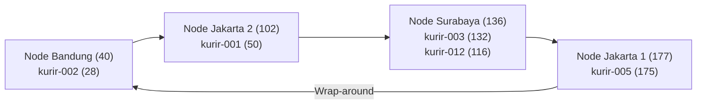
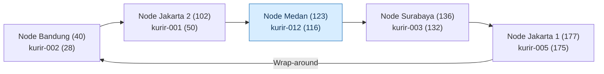
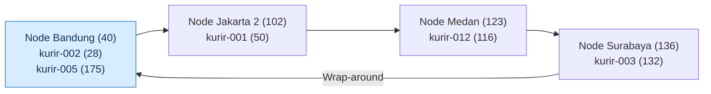

## Analisis - ditulis oleh Rovino Ramadhani

### 1. Alasan Penggunaan DHT/Chord pada FoodGo

Pada studi kasus FoodGo, setiap kurir memiliki ID tetap, tetapi alamat IP dapat berubah ketika kurir berpindah lokasi
atau menggunakan jaringan yang berbeda. Kondisi ini membutuhkan mekanisme pencarian alamat IP yang mampu memperbarui
mapping tanpa bergantung pada satu server pusat.

Penggunaan DHT dengan algoritma Chord dinilai lebih sesuai karena:

1. Flat naming dengan tabel pusat menyimpan seluruh mapping ID kurir dan alamat IP dalam satu server. Ketika jumlah
   kurir meningkat, server tersebut berpotensi mengalami bottleneck. Jika server mengalami gangguan, proses pencarian
   alamat IP juga dapat terhenti.
2. DNS konvensional menggunakan struktur penamaan hierarkis dan mekanisme caching. Meskipun DNS mendukung pembaruan
   alamat IP, perubahan yang terlalu sering dapat menyebabkan cache menyimpan alamat lama hingga masa TTL berakhir.
3. Chord DHT mendistribusikan tanggung jawab penyimpanan mapping berdasarkan hasil hashing. Setiap ID kurir dipetakan ke
   node successor sehingga proses pencarian tidak harus bergantung pada satu server pusat.

Dengan pendekatan tersebut, FoodGo dapat mempertahankan ID kurir yang sama meskipun alamat IP berubah. Pembaruan IP
cukup dilakukan pada mapping ID kurir, sedangkan penentuan node penanggung jawab mengikuti algoritma consistent hashing.

Pada implementasi terdistribusi sebenarnya, diperlukan mekanisme replikasi dan pemulihan node untuk meningkatkan
ketahanan sistem terhadap kegagalan. Sementara itu, simulasi yang dibuat hanya menunjukkan pembagian tanggung jawab
secara logis dalam satu proses Python.

### 2. Consistent Hashing dan Ring Topology

Simulasi menggunakan ruang identifier 8-bit dengan rentang hash 0 sampai 255. Fungsi SHA-1 digunakan untuk menghasilkan
nilai hash yang kemudian disesuaikan dengan ukuran ring menggunakan operasi modulo 256.

Pada kondisi awal, terdapat empat node yang tersusun berdasarkan nilai hash:

1. Node Bandung dengan ID 40.
2. Node Jakarta 2 dengan ID 102.
3. Node Surabaya dengan ID 136.
4. Node Jakarta 1 dengan ID 177.

Susunan tersebut membentuk ring dengan urutan 40 -> 102 -> 136 -> 177 -> 40.

Setiap ID kurir ditempatkan pada node yang memiliki nilai hash terkecil yang lebih besar atau sama dengan hash key. Jika
tidak terdapat node yang memenuhi kondisi tersebut, pencarian dilanjutkan ke node dengan ID terkecil melalui mekanisme
wrap-around.

#### 2.1 Diagram Ring Topology Awal



Diagram menunjukkan empat node yang membentuk ring berdasarkan urutan nilai hash. Masing-masing node bertanggung jawab
atas ID kurir yang berada pada rentang hash tertentu.

Pembagian tanggung jawab awal adalah:

1. Node 40 bertanggung jawab atas `kurir-002` dengan hash 28.
2. Node 102 bertanggung jawab atas `kurir-001` dengan hash 50.
3. Node 136 bertanggung jawab atas `kurir-003` dengan hash 132 dan `kurir-012` dengan hash 116.
4. Node 177 bertanggung jawab atas `kurir-005` dengan hash 175.

#### 2.2 Penelusuran Manual Proses Lookup

Sebagai contoh, proses `lookup("kurir-001")` dilakukan melalui tahapan berikut:

1. ID `kurir-001` diproses menggunakan fungsi `hash_id()` dan menghasilkan hash 50.
2. Algoritma mengurutkan seluruh ID node menjadi `[40, 102, 136, 177]`.
3. Pencarian dimulai dari node 40. Karena 40 lebih kecil daripada 50, node tersebut belum memenuhi aturan successor.
4. Pencarian dilanjutkan ke node 102. Karena 102 lebih besar daripada 50 dan merupakan ID terkecil yang memenuhi
   kondisi, node 102 ditetapkan sebagai successor.
5. Fungsi `lookup()` mengambil mapping `kurir-001` dari `self.data` dan mengembalikan alamat IP `192.168.1.10`.

Hasil tersebut membuktikan bahwa pemilihan node penanggung jawab dilakukan berdasarkan nilai hash, bukan berdasarkan
lokasi geografis maupun urutan pendaftaran node.

### 3. Perubahan Topologi Saat Join

Pada pengujian join, node Medan dengan ID 123 dan alamat IP `10.0.0.5` ditambahkan ke dalam ring.

Sebelum node tersebut bergabung, `kurir-012` dengan hash 116 menjadi tanggung jawab node 136. Setelah node 123
bergabung, node tersebut menjadi successor terdekat untuk hash 116.

#### 3.1 Diagram Ring Topology Setelah Join



Pada diagram tersebut, node Medan bergabung di antara node 102 dan node 136. Node baru mengambil alih tanggung jawab
untuk key dalam rentang `(102, 123]` yang sebelumnya menjadi tanggung jawab node 136.

Hasil pengujian menunjukkan:

1. Jumlah node meningkat dari empat menjadi lima.
2. Susunan ring berubah menjadi `[40, 102, 123, 136, 177]`.
3. Mapping `kurir-012` berpindah dari node 136 ke node 123.
4. Total mapping yang berpindah sebanyak satu.
5. Mapping kurir lainnya tetap berada pada node penanggung jawab sebelumnya.

Output program:

```text
[JOIN] Node 'node-medan-1' (id=123) bergabung, alamat 10.0.0.5
  Rentang (102, 123] beralih dari node 136 ke node 123
  Mapping kurir-012 (hash=116, IP=192.168.1.13): node 136 -> node 123
  Total mapping berpindah: 1
  Ring saat ini: [40, 102, 123, 136, 177]
```

Hasil tersebut menunjukkan bahwa consistent hashing memungkinkan penambahan node tanpa harus mengubah seluruh mapping
dalam ring. Perubahan tanggung jawab hanya terjadi pada key yang termasuk dalam rentang node baru.

### 4. Perubahan Topologi Saat Leave

Pada pengujian leave, `node-jakarta-1` dengan ID 177 dikeluarkan dari ring. Sebelum keluar, node tersebut bertanggung
jawab atas `kurir-005` yang memiliki hash 175.

Ketika node 177 dihapus, algoritma mencari successor berikutnya untuk mengambil alih tanggung jawab mapping. Karena
tidak terdapat node dengan ID lebih besar dari 177, pencarian kembali ke awal ring dan menemukan node 40.

#### 4.1 Diagram Ring Topology Setelah Leave



Diagram menunjukkan bahwa node 177 sudah tidak berada dalam ring. Tanggung jawab atas `kurir-005` berpindah ke node 40
melalui mekanisme wrap-around.

Hasil pengujian menunjukkan:

1. Jumlah node berkurang dari lima menjadi empat.
2. Susunan ring berubah menjadi `[40, 102, 123, 136]`.
3. Mapping `kurir-005` berpindah dari node 177 ke node 40.
4. Total mapping yang berpindah sebanyak satu.
5. Lookup `kurir-001` dan `kurir-002` tetap menghasilkan alamat IP yang sesuai.

Output program:

```text
[LEAVE] Node 'node-jakarta-1' (id=177) keluar dari ring
  Rentang (136, 177] beralih dari node 177 ke node 40
  Mapping kurir-005 (hash=175, IP=192.168.1.14): node 177 -> node 40
  Total mapping berpindah: 1
  Ring saat ini: [40, 102, 123, 136]
```

Perpindahan tersebut menunjukkan bahwa algoritma successor dapat menentukan node pengganti ketika terjadi perubahan
topologi. Mekanisme wrap-around memastikan bahwa key tetap memiliki node penanggung jawab selama ring tidak kosong.

Pada simulasi ini, mapping disimpan dalam struktur data bersama `self.data`, sehingga perpindahan yang ditampilkan
merupakan perubahan tanggung jawab secara logis, bukan perpindahan data fisik antarserver.

Berdasarkan hasil pengujian, perubahan topologi tidak mengubah alamat IP kurir yang telah terdaftar. Perubahan hanya
memengaruhi node yang bertanggung jawab terhadap mapping tersebut, sehingga proses lookup tetap dapat dilakukan setelah
node bergabung maupun keluar dari ring.