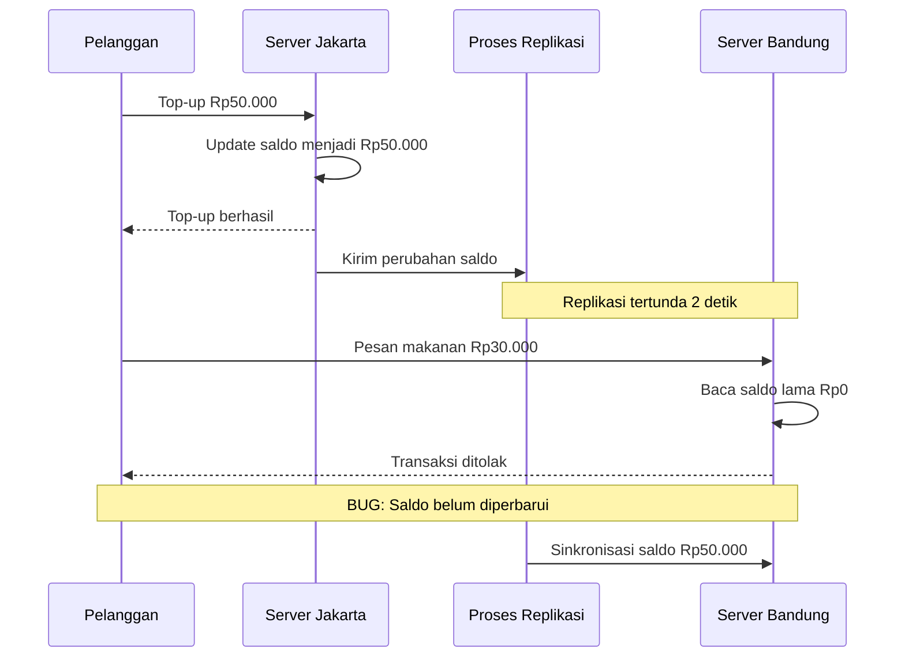
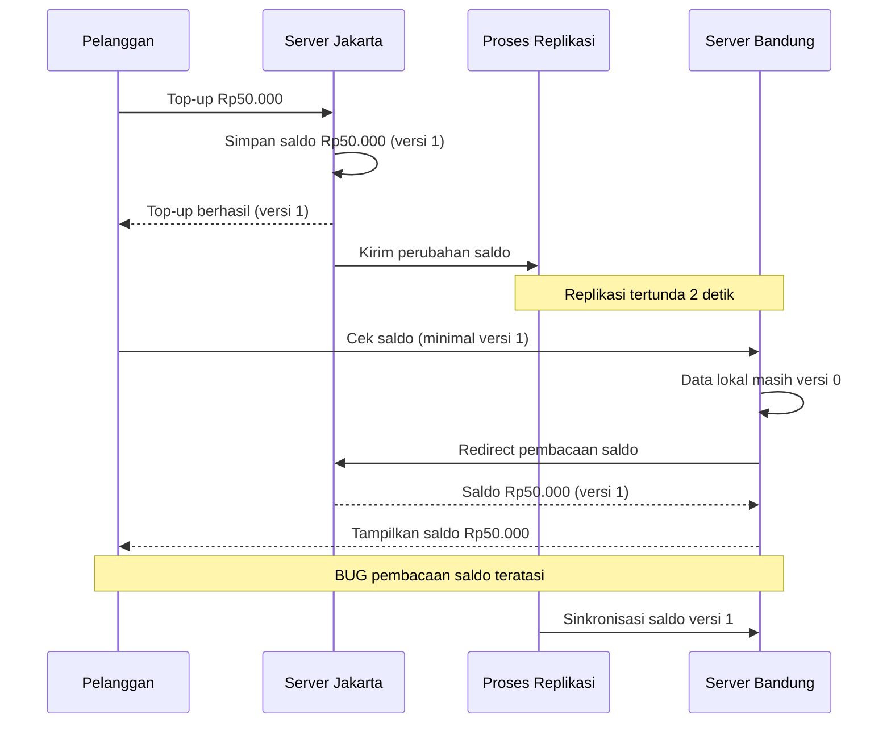

# Tugas 7 (Pekan 7) - Konsistensi Data

**Kelompok:** Kelompok 2

| Nama                    | NIM          | Kontribusi |
|-------------------------|--------------|------------|
| Rovino Ramadhani        | 103072400031 |            |
| Galang Herjuno Mulya    | 103072430006 |            |
| Erastus Liubeta Septian | 103072400020 |            |
## Jawaban Kelompok

### Bagian 1 - Analisis

#### 1. Pemilihan Model Konsistensi Data

Pada kasus e-wallet FoodGo, Eventual Consistency saja tidak cukup karena memungkinkan perbedaan saldo sementara antara
server Jakarta dan Bandung. Kondisi ini dapat menyebabkan transaksi ditolak meskipun pelanggan telah berhasil melakukan
top-up.

Sequential Consistency lebih sesuai untuk menjaga urutan operasi top-up dan pembacaan saldo. Namun, penerapannya perlu
didukung mekanisme konsistensi pada sisi pelanggan serta pengelolaan transaksi yang aman.

Dari sisi bisnis, ketidaksesuaian saldo dapat menyebabkan kegagalan transaksi, keluhan pelanggan, dan menurunnya
kepercayaan terhadap FoodGo. Dampaknya lebih serius dibandingkan keterlambatan pembaruan jumlah like pada media sosial
yang tidak berkaitan langsung dengan transaksi keuangan.

#### 2. Pendekatan Client-Centric Consistency

Solusi yang diusulkan adalah Read-Your-Writes, yaitu mekanisme yang memastikan pelanggan dapat membaca perubahan saldo
yang telah berhasil dilakukan sebelumnya.

Implementasinya dilakukan melalui tahapan berikut:

1. Pelanggan melakukan top-up melalui server Jakarta.
2. Server Jakarta memperbarui saldo dan mencatat nomor versi terbaru.
3. Ketika pelanggan mengakses server Bandung, sistem membandingkan versi data dengan versi minimum pelanggan.
4. Jika versi Bandung masih lama, pembacaan dialihkan ke server Jakarta.
5. Pelanggan mendapatkan saldo terbaru tanpa menunggu replikasi selesai.

Pendekatan ini memungkinkan replikasi tetap berjalan secara asinkron tanpa menyebabkan pelanggan membaca saldo lama
setelah top-up.

#### 3. Sequence Diagram

##### 3.1 Skenario Tanpa Jaminan Konsistensi

Pada skenario tersebut, pelanggan mengalami penolakan transaksi karena server Bandung masih membaca saldo Rp0, meskipun
server Jakarta sudah mencatat saldo Rp50.000.

##### 3.2 Skenario Dengan Read-Your-Writes

Pada skenario kedua, server Bandung mendeteksi versi data yang belum diperbarui dan mengalihkan pembacaan ke server
Jakarta. Dengan demikian, pelanggan tetap memperoleh informasi saldo terbaru.

### Bagian 2 - Simulasi

#### 1. Simulasi Inconsistent Read

Simulasi dilakukan menggunakan Python melalui file `src/replica_simulation.py` dengan dua replika, yaitu Jakarta dan
Bandung. Proses replikasi diberikan keterlambatan selama 2 detik menggunakan `threading.Timer()`.

Ketika pelanggan melakukan top-up Rp50.000 melalui Jakarta dan membaca saldo dari Bandung setelah 0,5 detik, hasil
pembacaan masih menunjukkan Rp0. Kondisi tersebut membuktikan terjadinya inconsistent read akibat keterlambatan
replikasi.

#### 2. Implementasi Read-Your-Writes

Mekanisme Read-Your-Writes diterapkan dengan menyimpan nomor versi pada setiap perubahan saldo. Sistem membandingkan
versi data pada server tujuan dengan versi minimum yang dibutuhkan pelanggan.

Setelah top-up tambahan Rp20.000, saldo terbaru menjadi Rp70.000. Ketika server Bandung belum memiliki versi terbaru,
pembacaan dialihkan ke Jakarta sehingga saldo Rp70.000 tetap dapat diperoleh.

#### 3. Hasil Pengujian Simulasi

Gambar di atas menunjukkan hasil eksekusi program Python. Pada skenario tanpa Read-Your-Writes, server Bandung
menampilkan saldo 0.0 meskipun pelanggan telah melakukan top-up Rp50.000. Setelah penerapan Read-Your-Writes, sistem
berhasil membaca saldo terbaru sebesar 70000.0 melalui pengalihan pembacaan ke server Jakarta, walaupun replikasi ke
Bandung belum selesai.
## Analisis Individu - Rovino Ramadhani

Berdasarkan hasil simulasi, terlihat bahwa keterlambatan replikasi data antara server Jakarta dan Bandung menyebabkan
perbedaan saldo sementara. Pada skenario tanpa Read-Your-Writes, saldo yang terbaca di server Bandung masih 0.0 meskipun
pelanggan sudah melakukan top-up sebesar 50000 melalui server Jakarta.

Setelah mekanisme Read-Your-Writes diterapkan, sistem dapat mendeteksi bahwa data di server Bandung belum diperbarui dan
mengalihkan pembacaan ke server Jakarta. Hasilnya, saldo terbaru sebesar 70000.0 berhasil ditampilkan tanpa harus
menunggu proses replikasi selesai.

### Tabel Perbandingan Hasil Simulasi

| Aspek              | Tanpa Read-Your-Writes | Dengan Read-Your-Writes   |
|--------------------|------------------------|---------------------------|
| Saldo terbaru      | 50000.0                | 70000.0                   |
| Saldo yang terbaca | 0.0                    | 70000.0                   |
| Server pembacaan   | Bandung                | Jakarta (redirect)        |
| Kondisi replikasi  | Belum selesai          | Belum selesai             |
| Konsistensi data   | Inconsistent Read      | Read-Your-Writes terjamin |
| Hasil simulasi     | BUG                    | BUG TERATASI              |
## Analisis Individu - Galang Herjuno Mulya

Berdasarkan kasus FoodGo, permasalahan utamanya terletak pada keterlambatan sinkronisasi data antara server Jakarta dan Bandung. Ketika pelanggan melakukan top-up di Jakarta, saldo memang sudah berhasil diperbarui. Namun, saat pelanggan berpindah dan mengakses server Bandung, belum tentu saldo tersebut sudah ikut diperbarui. Akibatnya, pelanggan bisa mengalami penolakan saat memesan makanan, padahal sebenarnya saldo mereka sudah mencukupi.

### Penilaian Model Konsistensi

Menurut saya, Eventual Consistency saja masih kurang tepat, terutama untuk data yang berhubungan dengan saldo pelanggan. Memang pada akhirnya kedua server akan memiliki data yang sama, tetapi masalahnya adalah pelanggan membutuhkan informasi saldo yang akurat pada saat melakukan transaksi, bukan beberapa detik setelahnya.

Keterlambatan seperti ini cukup berisiko bagi FoodGo. Bayangkan pelanggan sudah melakukan top-up, tetapi tetap tidak bisa memesan makanan karena sistem membaca saldo lama. Selain membuat pelanggan kesal, hal tersebut juga bisa mengurangi kepercayaan terhadap aplikasi. Kondisi ini tentu berbeda dengan keterlambatan pembaruan jumlah like atau informasi lain yang tidak berpengaruh langsung terhadap transaksi.

Sequential Consistency sebagai model yang digunakan dalam analisis. Model ini mempertimbangkan urutan operasi, sehingga proses top-up dan pembacaan saldo dapat dipahami secara berurutan. Selain itu, kami juga mengusulkan penggunaan Read-Your-Writes agar pelanggan tetap bisa melihat saldo terbaru setelah melakukan top-up, meskipun berpindah server. Untuk melihat bagaimana mekanisme tersebut bekerja, kami melakukan simulasi dengan membandingkan versi data pada masing-masing server.

## Analisis Individu - Erastus Liubeta Septian

### 1. Kebutuhan Model Konsistensi Data: Eventual vs. Sequential Consistency
Pada sistem e-wallet FoodGo, model **Eventual Consistency murni jelas tidak cukup**. Model ini membiarkan data antar-server berbeda sementara waktu sebelum akhirnya sinkron. Untuk urusan saldo uang, jeda replikasi tersebut berdampak langsung pada operasional:
- **Dampak Bisnis & Finansial:** Kasus saldo e-wallet sangat berbeda dengan jumlah *like* di media sosial. Pada media sosial, perbedaan beberapa angka like selama beberapa detik tidak merugikan siapa pun. Namun pada e-wallet, jika pelanggan baru saja top-up di server Jakarta lalu memesan makanan di server Bandung dan saldonya masih terbaca 0, transaksi akan langsung ditolak. Pelanggan merasa uangnya hilang, komplain melonjak, dan reputasi aplikasi akan jatuh.

Meski begitu, menerapkan **Sequential Consistency penuh** pada seluruh replika (Jakarta dan Bandung) juga kurang tepat karena membutuhkan koordinasi sinkron global setiap kali ada penulisan data. Hal ini akan membuat proses transaksi menjadi lambat dan sistem mudah terganggu jika jaringan antar-kota mengalami kendala.

### 2. Solusi Tepat: Client-Centric Consistency (Read-Your-Writes)
Pendekatan yang paling pas untuk kasus ini adalah **Client-Centric Consistency**, khususnya **Read-Your-Writes**:
- Pelanggan sebenarnya tidak menuntut seluruh pengguna lain melihat saldo terbarunya seketika itu juga, melainkan dirinya sendiri yang harus selalu melihat hasil transaksinya yang paling baru.
- **Cara kerjanya:** Setiap kali top-up berhasil, server mencatat nomor versi terbaru (misal versi 1, versi 2). Saat pelanggan membaca saldo dari server Bandung, aplikasi menyertakan versi minimum yang diharapkan. Jika data di server Bandung masih versi lama, sistem otomatis mengalihkan (*redirect*) pembacaan ke server Jakarta yang memegang data terbaru. Replikasi antar-server tetap bisa berjalan asinkron di latar belakang tanpa mengganggu kenyamanan pengguna.

### 3. Analisis Hasil Simulasi Program (`replica_simulation.py`)
Dari hasil pengujian simulasi pada file `replica_simulation.py`:
- **Skenario Naif (Tanpa Read-Your-Writes):** Pelanggan top-up Rp50.000 di Jakarta, lalu 0.5 detik kemudian mengecek saldo dari server Bandung. Karena ada delay replikasi 2.0 detik, server Bandung mengembalikan saldo `0.0`. Ini membuktikan terjadinya *inconsistent read* yang menyebabkan transaksi ditolak.
- **Skenario dengan Read-Your-Writes:** Setelah top-up kedua menjadi Rp70.000 (versi 2), server Bandung mendeteksi bahwa versinya masih versi 1. Sistem langsung mengalihkan pembacaan ke Jakarta, sehingga saldo Rp70.000 berhasil terbaca dengan benar dan bug teratasi tanpa harus menunggu replikasi selesai.

### 4. Skenario Tambahan (Aplikasi Transportasi Online)
Sebagai pembanding pada kasus aplikasi ojek online:
- **Penerimaan Order / Booking Driver:** Membutuhkan **Sequential Consistency**. Ketika dua pelanggan memesan driver yang sama di waktu bersamaan, sistem wajib memastikan urutan pemesanan secara ketat agar tidak terjadi *double booking* pada satu driver.
- **Pelacakan Posisi GPS Driver:** Cukup menggunakan **Eventual / Monotonic-Read Consistency**. Jika koordinat driver di peta penumpang sedikit terlambat diperbarui antar-server, hal tersebut tidak membatalkan pesanan atau merugikan keuangan pengguna.

### 5. Kesimpulan
1. Saldo e-wallet tidak bisa mengandalkan *Eventual Consistency* murni karena menyangkut uang nyata dan kepercayaan pelanggan.
2. Mekanisme *Read-Your-Writes* adalah solusi paling seimbang: menjamin pelanggan selalu melihat data terbarunya sendiri tanpa harus membebani sistem dengan koordinasi global yang lambat.
3. Simulasi program membuktikan bahwa pengecekan nomor versi dan mekanisme pengalihan baca (*redirect*) berhasil mencegah pembacaan data lama (*stale read*) saat proses replikasi sedang tertunda.

## Kesimpulan Kelompok

