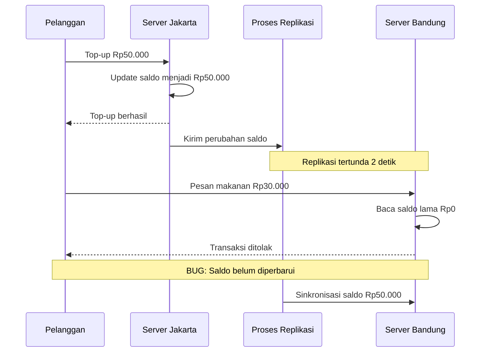
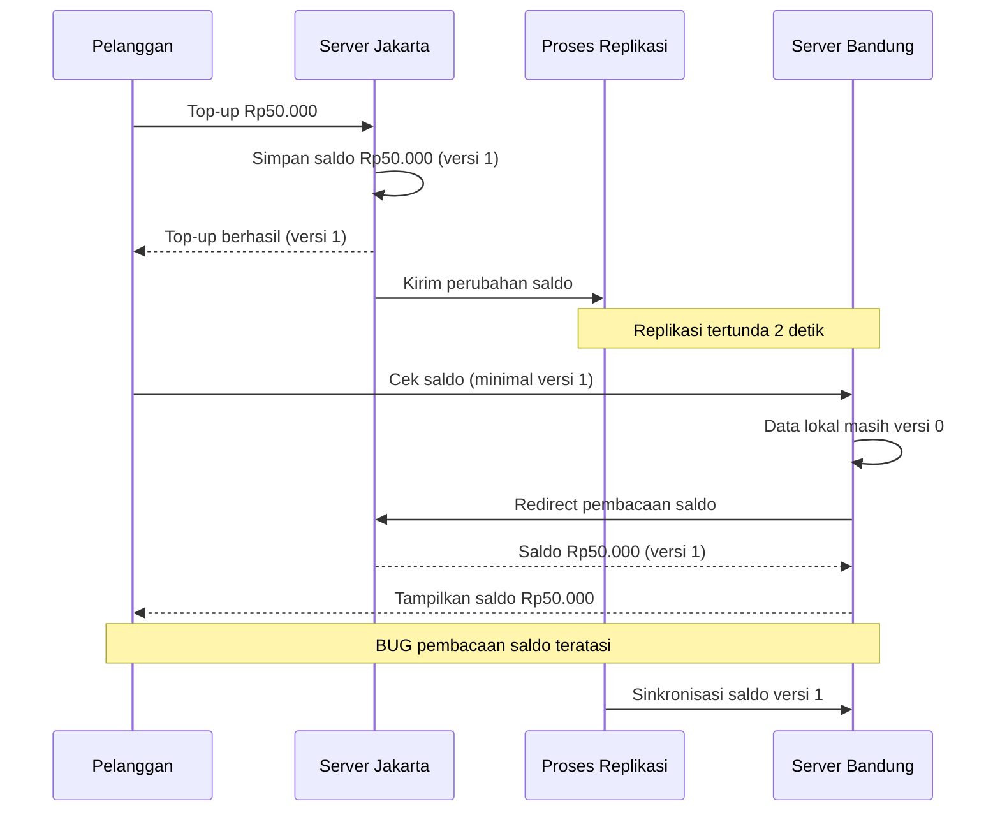
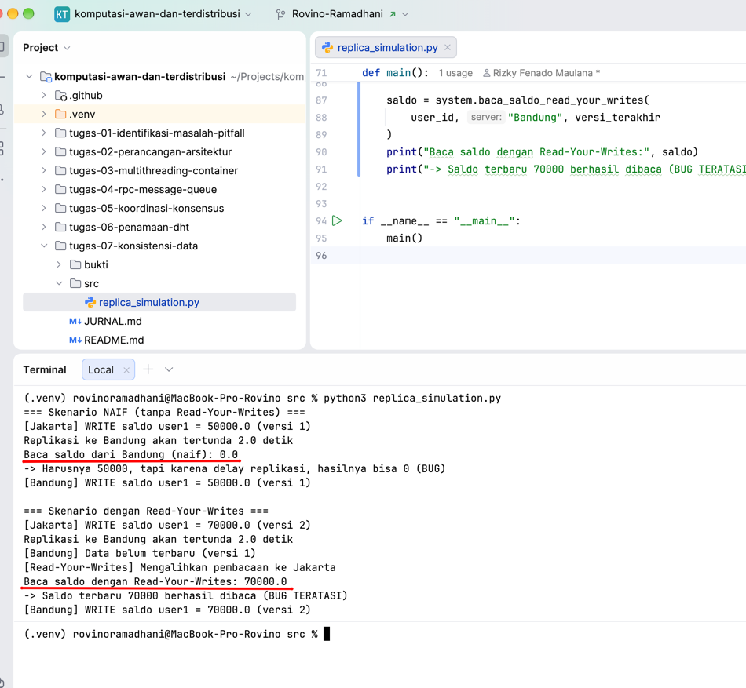

## Jawaban Kelompok

### Bagian 1 - Analisis

#### 1. Pemilihan Model Konsistensi Data

Pada kasus e-wallet FoodGo, Eventual Consistency saja tidak cukup karena memungkinkan perbedaan saldo sementara antara
server Jakarta dan Bandung. Kondisi ini dapat menyebabkan transaksi ditolak meskipun pelanggan telah berhasil melakukan
top-up.

Sequential Consistency lebih sesuai untuk menjaga urutan operasi top-up dan pembacaan saldo. Namun, penerapannya perlu
didukung mekanisme konsistensi pada sisi pelanggan serta pengelolaan transaksi yang aman.

Dari sisi bisnis, ketidaksesuaian saldo dapat menyebabkan kegagalan transaksi, keluhan pelanggan, dan menurunnya
kepercayaan terhadap FoodGo. Dampaknya lebih serius dibandingkan keterlambatan pembaruan jumlah like pada media sosial
yang tidak berkaitan langsung dengan transaksi keuangan.

#### 2. Pendekatan Client-Centric Consistency

Solusi yang diusulkan adalah Read-Your-Writes, yaitu mekanisme yang memastikan pelanggan dapat membaca perubahan saldo
yang telah berhasil dilakukan sebelumnya.

Implementasinya dilakukan melalui tahapan berikut:

1. Pelanggan melakukan top-up melalui server Jakarta.
2. Server Jakarta memperbarui saldo dan mencatat nomor versi terbaru.
3. Ketika pelanggan mengakses server Bandung, sistem membandingkan versi data dengan versi minimum pelanggan.
4. Jika versi Bandung masih lama, pembacaan dialihkan ke server Jakarta.
5. Pelanggan mendapatkan saldo terbaru tanpa menunggu replikasi selesai.

Pendekatan ini memungkinkan replikasi tetap berjalan secara asinkron tanpa menyebabkan pelanggan membaca saldo lama
setelah top-up.

#### 3. Sequence Diagram

##### 3.1 Skenario Tanpa Jaminan Konsistensi

Pada skenario tersebut, pelanggan mengalami penolakan transaksi karena server Bandung masih membaca saldo Rp0, meskipun
server Jakarta sudah mencatat saldo Rp50.000.

##### 3.2 Skenario Dengan Read-Your-Writes

Pada skenario kedua, server Bandung mendeteksi versi data yang belum diperbarui dan mengalihkan pembacaan ke server
Jakarta. Dengan demikian, pelanggan tetap memperoleh informasi saldo terbaru.

### Bagian 2 - Simulasi

#### 1. Simulasi Inconsistent Read

Simulasi dilakukan menggunakan Python melalui file `src/replica_simulation.py` dengan dua replika, yaitu Jakarta dan
Bandung. Proses replikasi diberikan keterlambatan selama 2 detik menggunakan `threading.Timer()`.

Ketika pelanggan melakukan top-up Rp50.000 melalui Jakarta dan membaca saldo dari Bandung setelah 0,5 detik, hasil
pembacaan masih menunjukkan Rp0. Kondisi tersebut membuktikan terjadinya inconsistent read akibat keterlambatan
replikasi.

#### 2. Implementasi Read-Your-Writes

Mekanisme Read-Your-Writes diterapkan dengan menyimpan nomor versi pada setiap perubahan saldo. Sistem membandingkan
versi data pada server tujuan dengan versi minimum yang dibutuhkan pelanggan.

Setelah top-up tambahan Rp20.000, saldo terbaru menjadi Rp70.000. Ketika server Bandung belum memiliki versi terbaru,
pembacaan dialihkan ke Jakarta sehingga saldo Rp70.000 tetap dapat diperoleh.

#### 3. Hasil Pengujian Simulasi

Gambar di atas menunjukkan hasil eksekusi program Python. Pada skenario tanpa Read-Your-Writes, server Bandung
menampilkan saldo 0.0 meskipun pelanggan telah melakukan top-up Rp50.000. Setelah penerapan Read-Your-Writes, sistem
berhasil membaca saldo terbaru sebesar 70000.0 melalui pengalihan pembacaan ke server Jakarta, walaupun replikasi ke
Bandung belum selesai.