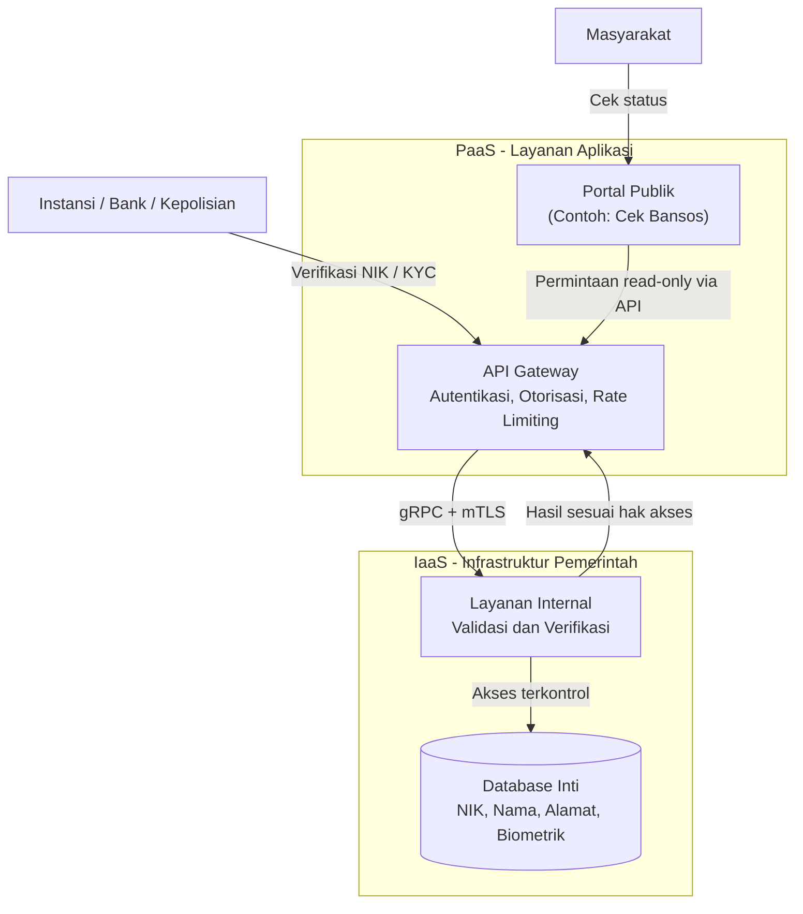

# Tugas 7 (Pekan 7) - Konsistensi Data

**Mata Kuliah:** Komputasi Awan dan Terdistribusi

**Kelompok:** Kelompok 2

| Nama                    | NIM          | Kontribusi                                                                                                                                                                                                                     |
|-------------------------|--------------|--------------------------------------------------------------------------------------------------------------------------------------------------------------------------------------------------------------------------------|
| Rovino Ramadhani        | 103072400031 | Menyusun jawaban kelompok, menganalisis hasil simulasi, membuat sequence diagram, mengimplementasikan simulasi replikasi dan Read-Your-Writes, menyiapkan bukti pengujian, serta mengelola struktur dan integrasi dokumentasi. |
| Galang Herjuno Mulya    | 103072430006 | Menganalisis permasalahan konsistensi saldo FoodGo, membandingkan Eventual dan Sequential Consistency, menjelaskan dampak bisnis keterlambatan replikasi, serta mengusulkan Read-Your-Writes.                                  |
| Erastus Liubeta Septian | 103072400020 | Menganalisis pemilihan model konsistensi, mengkaji mekanisme Client-Centric Consistency, mengevaluasi hasil simulasi, serta memberikan contoh penerapan konsistensi pada aplikasi transportasi online.                         |

## Pembagian Tanggung Jawab

1. **Rovino Ramadhani:** Implementasi simulasi, pengujian, dokumentasi teknis, jawaban kelompok, dan integrasi hasil
   pekerjaan.
2. **Galang Herjuno Mulya:** Analisis kebutuhan konsistensi data dan pengaruhnya terhadap operasional serta kepercayaan
   pelanggan FoodGo.
3. **Erastus Liubeta Septian:** Analisis pendekatan konsistensi, evaluasi hasil pengujian, dan pengembangan skenario
   pembanding.
## Jawaban Nomor 2 - Ditulis Oleh Rovino Ramadhani

Dalam sistem data kependudukan, tidak semua komponen harus menggunakan model layanan cloud yang sama. Ada bagian yang
membutuhkan kendali penuh karena menyimpan data sensitif, tetapi ada juga bagian yang lebih membutuhkan kemudahan
pengelolaan dan skalabilitas. Oleh karena itu, kombinasi IaaS dan PaaS menjadi pilihan yang sesuai dengan kebutuhan
masing-masing komponen.

### 1. Database Inti Menggunakan IaaS

Untuk database utama yang menyimpan NIK, nama, alamat, hingga data biometrik, IaaS (Infrastructure as a Service) menjadi
pilihan yang tepat. Alasannya, data tersebut sangat sensitif sehingga pemerintah perlu memiliki kendali terhadap
infrastruktur yang digunakan.

Konsepnya seperti membangun pusat data sendiri yang dikelola oleh pemerintah. Dengan menggunakan IaaS pada infrastruktur
milik negara, pemerintah dapat mengatur server, sistem operasi, jaringan, penyimpanan, hingga keamanan database sesuai
kebutuhannya.

Selain itu, masalah kepercayaan terhadap penyedia layanan pihak ketiga juga perlu dipertimbangkan. Meskipun penyedia
cloud memiliki sistem keamanan yang baik, penggunaan infrastruktur milik pihak lain tetap menimbulkan ketergantungan.
Karena itu, pendekatan *zero trust* perlu diterapkan agar setiap akses tetap diperiksa dan dibatasi, termasuk akses dari
layanan internal.

Lokasi pusat data juga perlu diperhatikan. Jika server berada di luar negeri, misalnya Singapura, komunikasi data harus
melewati jaringan internasional yang dapat menambah latensi dibandingkan koneksi domestik dengan kondisi jaringan yang
setara.

### 2. Portal Publik Menggunakan PaaS

Untuk portal publik, PaaS (Platform as a Service) lebih cocok digunakan karena kebutuhan pengelolaannya berbeda dengan
database inti. Contohnya seperti layanan Cek Bansos, ketika masyarakat memasukkan informasi tertentu untuk mengetahui
status bantuan yang diterima.

Portal seperti ini tidak harus menyimpan seluruh data kependudukan. Aplikasi cukup mengirimkan permintaan ke layanan
pusat melalui API atau gRPC, kemudian menampilkan informasi yang memang boleh diketahui pengguna.

Akan lebih baik jika portal tidak diberikan akses langsung ke database utama. Aksesnya cukup melalui layanan khusus yang
hanya menyediakan operasi pembacaan (read-only) untuk informasi tertentu. Dengan begitu, jika terjadi kebocoran
kredensial portal, akses tersebut dapat segera dicabut tanpa memberikan kemampuan untuk mengubah data kependudukan.

Alasan lainnya adalah skalabilitas. Ketika banyak masyarakat mengakses portal secara bersamaan, misalnya saat
pendaftaran sekolah atau pengecekan bantuan sosial, kapasitas aplikasi dapat ditingkatkan melalui fasilitas scaling yang
disediakan platform PaaS.

### 3. API Verifikasi NIK/KYC Menggunakan PaaS

Untuk kebutuhan verifikasi identitas oleh instansi seperti kepolisian atau perbankan, PaaS juga menjadi pilihan yang
sesuai. Namun, aksesnya tidak diberikan langsung ke database kependudukan, melainkan melalui API Gateway.

API Gateway berfungsi sebagai pintu penghubung antara aplikasi instansi dengan sistem pusat. Sebagai contoh, ketika bank
ingin memverifikasi NIK untuk proses KYC, bank mengirimkan permintaan melalui gateway. Selanjutnya, gateway meneruskan
permintaan ke layanan internal yang terhubung dengan database inti, misalnya menggunakan gRPC.

Dengan cara ini, instansi hanya menerima hasil verifikasi sesuai kebutuhannya, bukan seluruh informasi penduduk. Setiap
permintaan juga dapat dibatasi menggunakan autentikasi, otorisasi, dan rate limiting agar layanan tidak digunakan secara
sembarangan.

PaaS dipilih karena jumlah permintaan verifikasi dari berbagai instansi bisa berubah sewaktu-waktu. Infrastruktur
aplikasi gateway dapat ditingkatkan kapasitasnya tanpa harus mengubah pengelolaan database utama.

### Kesimpulan - Soal Nomor 2

IaaS digunakan untuk database inti karena data kependudukan membutuhkan kendali infrastruktur yang kuat dari pemerintah.
Sementara itu, PaaS lebih cocok untuk portal publik dan API Gateway karena lebih mudah dikelola serta dapat menyesuaikan
kapasitas ketika jumlah pengguna meningkat.

Hal terpenting dari rancangan ini adalah memastikan data sensitif tetap berada dalam kendali pemerintah. Portal maupun
instansi eksternal tidak diberikan akses langsung ke database, tetapi harus melalui layanan penghubung dengan hak akses
yang dibatasi.
## Jawaban Nomor 4 - Ditulis Oleh Erastus Liubeta Septian

### Alternatif yang Ditolak: Private Cloud Murni

Kelompok kami menolak **Private Cloud Murni** sebagai deployment model untuk Sistem Data Kependudukan, meskipun secara sepintas ia tampak ideal karena infrastruktur 100% berada di bawah kendali negara.

---

#### Alasan Penolakan Berdasarkan Karakteristik NIST SP 800-145

**1. Lemah pada *Rapid Elasticity***

Private Cloud dibatasi oleh kapasitas fisik perangkat keras yang terpasang di data center pemerintah — tidak ada mekanisme *auto-scaling* berbasis *resource pool* eksternal. Pola akses sistem kependudukan sangat tidak merata:
- Saat **Pemilu Serentak**, puluhan juta pengecekan status DPT terjadi dalam hitungan hari oleh petugas KPU/Bawaslu dan masyarakat.
- Saat **PPDB**, jutaan validasi NIK dan Kartu Keluarga terjadi dalam rentang 1–2 minggu.

Untuk tidak *downtime*, satu-satunya cara adalah *over-provisioning* — membangun kapasitas yang cukup untuk menanggung beban puncak tersebut. Di luar musim puncak, utilisasi server bisa serendah 10–15%, tetapi biaya operasional (listrik, pendingin, pemeliharaan) tetap berjalan penuh. Ini secara langsung melanggar prinsip ***Measured Service*** NIST, di mana sumber daya seharusnya digunakan dan dibayar secara proporsional terhadap konsumsi riil.

**2. Hambatan Struktural: Siklus Pengadaan Pemerintah**

Berbeda dengan Public Cloud yang elastis dalam hitungan menit, penambahan kapasitas fisik pada Private Cloud memerlukan proses pengadaan barang dan jasa pemerintah (*procurement*) yang bisa memakan waktu berminggu-minggu hingga berbulan-bulan. Ini menjadikan *rapid elasticity* secara praktis tidak dapat dipenuhi — bukan hanya karena keterbatasan teknis, tetapi karena kendala birokrasi pengadaan yang melekat pada infrastruktur fisik milik negara.

---

#### Mengapa Ini Bukan Alasan "Private Cloud Lebih Aman tanpa Detail"

Argumen penolakan di atas tidak menyentuh aspek keamanan/kerahasiaan, karena memang di sisi itu Private Cloud Murni *unggul* — data fisik sepenuhnya di bawah kendali negara dan memenuhi asas kedaulatan data UU PDP. Penolakan ini murni berbasis dua kegagalan karakteristik NIST yang tidak bisa disiasati tanpa keluar dari model Private Cloud Murni itu sendiri: **Rapid Elasticity** dan **Measured Service**.

---

#### Skenario Tandingan: "Bagaimana Jika Private Cloud Diperkuat dengan Kapasitas Cadangan?"

> *"Apakah Private Cloud Murni masih bisa diterima jika pemerintah menyiapkan server cadangan khusus untuk periode puncak?"*

**Jawaban:** Tidak. Membangun kapasitas cadangan untuk beban puncak sesungguhnya *adalah* definisi dari *over-provisioning* — masalah yang sama yang membuat model ini ditolak. Kapasitas cadangan tersebut hanya aktif 2–3 kali setahun, namun biaya kepemilikan (*CAPEX* dan *OPEX*) berjalan sepanjang tahun. Dibandingkan dengan Hybrid Cloud yang hanya membayar *resource* cloud publik saat lonjakan terjadi (*pay-as-you-go*), pendekatan ini jauh lebih mahal tanpa keuntungan fungsional tambahan.

---

#### Rekomendasi sebagai Perbandingan

Model yang kami pilih, **Hybrid Cloud**, menyelesaikan ketegangan ini secara langsung: lapisan *API Gateway* dan *stateless verification service* yang melayani ribuan instansi eksternal berjalan di Public/Community Cloud yang elastis, sementara *Master Database* biometrik dan NIK tetap terkunci di Private Cloud pemerintah — tidak pernah berpindah ke infrastruktur eksternal, sehingga kedaulatan data tetap terjaga.

## Analisis Individu - Nama

## Jawaban Nomor 3 - Ditulis oleh Assyifa Dwi Safitri

### a. Risiko layanan verifikasi tidak mampu menampung lonjakan permintaan

Pada puncak musim pemilu atau penerimaan sekolah, banyak instansi bisa mengirim permintaan dalam waktu hampir bersamaan. Karena Private Cloud bergantung pada kapasitas perangkat yang dimiliki pemerintah, penambahan instans aplikasi tidak akan membantu apabila CPU, memori, atau database sudah mencapai batas fisik. Akibatnya, permintaan menumpuk dan proses validasi identitas terlambat.

#### Mitigasi:

- Menyusun *Capacity Planning* berdasarkan perkiraan permintaan puncak dan menyediakan cadangan server serta kapasitas basis data.
- Menggunakan *load balancer*, autoscaling internal, antrean pemrosesan, serta pembatasan laju permintaan (*rate limiting*) per instansi.
- Menjalankan pengujian beban sebelum periode sibuk dan menetapkan prioritas layanan penting.

### b. Risiko penyalahgunaan hak akses oleh pengguna dari instansi mitra

Ribuan petugas dan sistem terhubung ke layanan kependudukan. Akun yang dicuri atau izin akses yang terlalu luas dapat digunakan untuk melakukan pencarian NIK massal, melihat data yang tidak terkait tugas, atau mengumpulkan identitas warga. Risiko ini tetap ada walaupun seluruh data ditempatkan dalam Private Cloud.

#### Mitigasi:

- Menggunakan autentikasi multifaktor untuk petugas, identitas aplikasi yang kuat untuk API, dan prinsip *least privilege* dengan RBAC/ABAC.
- Mewajibkan otoritasi berdasarkan tujuan penggunaan, membatasi atribut dalam respons, serta menerapkan kuota pencarian per lembaga.
- Menerapkan pemantauan anomali, audit aksese, dan prosedur pencabutan akun/token serta tidak menyimpan NIK lengkap pada log operasional.

### c. Risiko gangguan pusat data pemerintah menyebabkan layanan nasional terhenti

Jika pusat data utama mengalami gangguan listrik, jaringan, bencana, atau kegagalan penyimpanan, layanan verifikasi dari berbagai daerah bisa ikut terdampak. Konsentrasi infrastruktur di bawah satu operator memperbesar dampak apabila tidak ada rancangan pemulihan.

#### Mitigasi:

- Menyediakan pusat data cadangan pemerintah di lokasi geografis berbeda, dengan replikasi terenkripsi dan hak akses setara.
- Menentukan target pemulihan (RTO/RPO), menyiapkan prosedur *failover*, dan menguji pemulihan secara berkala.
- Memisahkan sistem cadangan dari hak akses operasional sehari-hari untuk mengurangi risiko kerusakan atau penghapusan serentak.

### Kesimpulan - Soal Nomor 3

Berdasarkan analisis risiko dan mitigasi, penggunaan Private Cloud pada Sistem Data Kependudukan memiliki beberapa tantangan, yaitu keterbatasan kapasitas saat terjadi lonjakan akses, penyalahgunaan hak akses oleh instansi, serta gangguan pada pusat data pemerintah. Risiko tersebut dapat diminimalkan melalui perencanaan kapasitas, penerapan *load balancing* dan *autoscaling*, pengaturan hak akses yang ketat, serta penyediaan pusat data cadangan. Dengan mitigasi yang tepat, Private Cloud dapat menjaga keamanan dan kerahasiaan data penduduk sekaligus mendukung ketersediaan layanan bagi ribuan instansi. Oleh karena itu, keberhasilan Private Cloud tidak hanya bergantung pada pemilihan model cloud, tetapi juga pada pengelolaan keamanan, kapasitas, dan keandalan infrastruktur secara berkelanjutan.

## Kesimpulan Kelompok

