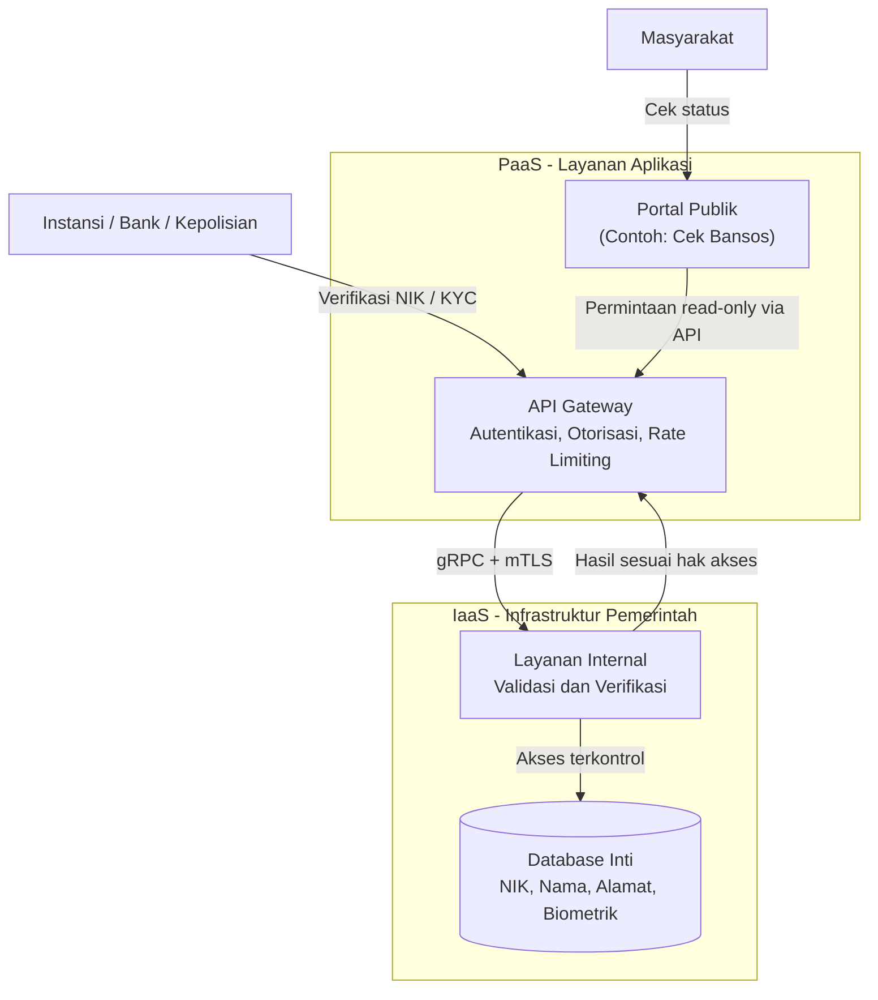

## Jawaban Nomor 2 - Ditulis Oleh Rovino Ramadhani

Dalam sistem data kependudukan, tidak semua komponen harus menggunakan model layanan cloud yang sama. Ada bagian yang
membutuhkan kendali penuh karena menyimpan data sensitif, tetapi ada juga bagian yang lebih membutuhkan kemudahan
pengelolaan dan skalabilitas. Oleh karena itu, kombinasi IaaS dan PaaS menjadi pilihan yang sesuai dengan kebutuhan
masing-masing komponen.

### 1. Database Inti Menggunakan IaaS

Untuk database utama yang menyimpan NIK, nama, alamat, hingga data biometrik, IaaS (Infrastructure as a Service) menjadi
pilihan yang tepat. Alasannya, data tersebut sangat sensitif sehingga pemerintah perlu memiliki kendali terhadap
infrastruktur yang digunakan.

Konsepnya seperti membangun pusat data sendiri yang dikelola oleh pemerintah. Dengan menggunakan IaaS pada infrastruktur
milik negara, pemerintah dapat mengatur server, sistem operasi, jaringan, penyimpanan, hingga keamanan database sesuai
kebutuhannya.

Selain itu, masalah kepercayaan terhadap penyedia layanan pihak ketiga juga perlu dipertimbangkan. Meskipun penyedia
cloud memiliki sistem keamanan yang baik, penggunaan infrastruktur milik pihak lain tetap menimbulkan ketergantungan.
Karena itu, pendekatan *zero trust* perlu diterapkan agar setiap akses tetap diperiksa dan dibatasi, termasuk akses dari
layanan internal.

Lokasi pusat data juga perlu diperhatikan. Jika server berada di luar negeri, misalnya Singapura, komunikasi data harus
melewati jaringan internasional yang dapat menambah latensi dibandingkan koneksi domestik dengan kondisi jaringan yang
setara.

### 2. Portal Publik Menggunakan PaaS

Untuk portal publik, PaaS (Platform as a Service) lebih cocok digunakan karena kebutuhan pengelolaannya berbeda dengan
database inti. Contohnya seperti layanan Cek Bansos, ketika masyarakat memasukkan informasi tertentu untuk mengetahui
status bantuan yang diterima.

Portal seperti ini tidak harus menyimpan seluruh data kependudukan. Aplikasi cukup mengirimkan permintaan ke layanan
pusat melalui API atau gRPC, kemudian menampilkan informasi yang memang boleh diketahui pengguna.

Akan lebih baik jika portal tidak diberikan akses langsung ke database utama. Aksesnya cukup melalui layanan khusus yang
hanya menyediakan operasi pembacaan (read-only) untuk informasi tertentu. Dengan begitu, jika terjadi kebocoran
kredensial portal, akses tersebut dapat segera dicabut tanpa memberikan kemampuan untuk mengubah data kependudukan.

Alasan lainnya adalah skalabilitas. Ketika banyak masyarakat mengakses portal secara bersamaan, misalnya saat
pendaftaran sekolah atau pengecekan bantuan sosial, kapasitas aplikasi dapat ditingkatkan melalui fasilitas scaling yang
disediakan platform PaaS.

### 3. API Verifikasi NIK/KYC Menggunakan PaaS

Untuk kebutuhan verifikasi identitas oleh instansi seperti kepolisian atau perbankan, PaaS juga menjadi pilihan yang
sesuai. Namun, aksesnya tidak diberikan langsung ke database kependudukan, melainkan melalui API Gateway.

API Gateway berfungsi sebagai pintu penghubung antara aplikasi instansi dengan sistem pusat. Sebagai contoh, ketika bank
ingin memverifikasi NIK untuk proses KYC, bank mengirimkan permintaan melalui gateway. Selanjutnya, gateway meneruskan
permintaan ke layanan internal yang terhubung dengan database inti, misalnya menggunakan gRPC.

Dengan cara ini, instansi hanya menerima hasil verifikasi sesuai kebutuhannya, bukan seluruh informasi penduduk. Setiap
permintaan juga dapat dibatasi menggunakan autentikasi, otorisasi, dan rate limiting agar layanan tidak digunakan secara
sembarangan.

PaaS dipilih karena jumlah permintaan verifikasi dari berbagai instansi bisa berubah sewaktu-waktu. Infrastruktur
aplikasi gateway dapat ditingkatkan kapasitasnya tanpa harus mengubah pengelolaan database utama.

### Kesimpulan - Soal Nomor 2

IaaS digunakan untuk database inti karena data kependudukan membutuhkan kendali infrastruktur yang kuat dari pemerintah.
Sementara itu, PaaS lebih cocok untuk portal publik dan API Gateway karena lebih mudah dikelola serta dapat menyesuaikan
kapasitas ketika jumlah pengguna meningkat.

Hal terpenting dari rancangan ini adalah memastikan data sensitif tetap berada dalam kendali pemerintah. Portal maupun
instansi eksternal tidak diberikan akses langsung ke database, tetapi harus melalui layanan penghubung dengan hak akses
yang dibatasi.